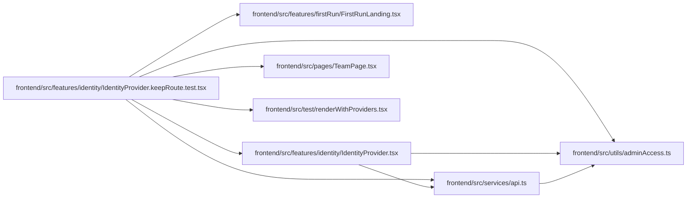

# IdentityProvider.keepRoute.test Module

**Path:** `frontend/src/features/identity/IdentityProvider.keepRoute.test.tsx`

## Description

_Auto-generated from `frontend/src/features/identity/IdentityProvider.keepRoute.test.tsx`._

## Imports

| Source | Symbols | Type-only | Runtime emission |
|--------|---------|-----------|------------------|
| `../../pages/TeamPage` | `TeamPage` | — | compiler-dependent |
| `../../services/api` | `api`, `setSessionIntegrity` | — | compiler-dependent |
| `../../test/renderWithProviders` | `renderWithProviders` | — | compiler-dependent |
| `../../utils/adminAccess` | `clearAdminApiKey`, `getAdminApiKey` | — | compiler-dependent |
| `../firstRun/FirstRunLanding` | `FirstRunLanding` | — | compiler-dependent |
| `./IdentityProvider` | `IdentityProvider` | — | compiler-dependent |
| `@testing-library/react` | `act`, `screen`, `waitFor` | — | compiler-dependent |
| `axios` | `AxiosResponse`, `InternalAxiosRequestConfig` | Declaration | erased |
| `axios` | `AxiosError` | — | compiler-dependent |
| `react-router-dom` | `Link`, `Route`, `Routes`, `useLocation` | — | compiler-dependent |
| `vitest` | `afterEach`, `beforeEach`, `describe`, `expect`, `it` | — | compiler-dependent |

## Module Signals

| Signal | Values |
|--------|--------|
| Constants | `local`, `originalAdapter` |
| Module calls | `describe` |

## Local dependency map

<!-- Auto-generated local dependency summary. Do not edit by hand. -->

### Internal neighbors

| Direction | Module |
|---|---|
| Outbound | [FirstRunLanding](../modules/FirstRunLanding.md) |
| Outbound | [IdentityProvider](../modules/IdentityProvider.md) |
| Outbound | [TeamPage](../modules/TeamPage.md) |
| Outbound | [api](../modules/api.md) |
| Outbound | [renderWithProviders](../modules/renderWithProviders.md) |
| Outbound | [adminAccess](../modules/adminAccess.md) |

### External packages

| Language | Used packages | Undeclared packages |
|---|---:|---:|
| typescript | 4 | 0 |
