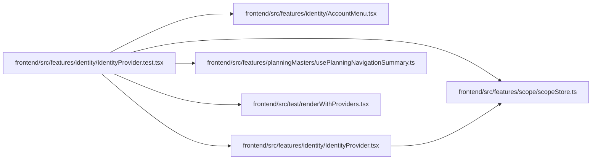

# IdentityProvider.test Module

**Path:** `frontend/src/features/identity/IdentityProvider.test.tsx`

## Description

_Auto-generated from `frontend/src/features/identity/IdentityProvider.test.tsx`._

## Imports

| Source | Symbols | Type-only | Runtime emission |
|--------|---------|-----------|------------------|
| `../../test/renderWithProviders` | `renderWithProviders` | — | compiler-dependent |
| `../planningMasters/usePlanningNavigationSummary` | `planningNavigationSummaryKey` | — | compiler-dependent |
| `../scope/scopeStore` | `useScopeStore` | — | compiler-dependent |
| `./AccountMenu` | `IdentityBadge` | — | compiler-dependent |
| `./IdentityProvider` | `IdentityProvider` | — | compiler-dependent |
| `@tanstack/react-query` | `QueryClient` | Declaration | erased |
| `@tanstack/react-query` | `useQueryClient` | — | compiler-dependent |
| `@testing-library/react` | `screen`, `waitFor`, `act` | — | compiler-dependent |
| `react` | `useEffect` | — | compiler-dependent |
| `vitest` | `beforeEach`, `describe`, `expect`, `it`, `vi` | — | compiler-dependent |

## Module Signals

| Signal | Values |
|--------|--------|
| Constants | `service` |
| Module calls | `service = hoisted`, `mock`, `describe` |

## Local dependency map

<!-- Auto-generated local dependency summary. Do not edit by hand. -->

### Internal neighbors

| Direction | Module |
|---|---|
| Outbound | [AccountMenu](../modules/AccountMenu.md) |
| Outbound | [IdentityProvider](../modules/IdentityProvider.md) |
| Outbound | [usePlanningNavigationSummary](../modules/usePlanningNavigationSummary.md) |
| Outbound | [scopeStore](../modules/scopeStore.md) |
| Outbound | [renderWithProviders](../modules/renderWithProviders.md) |

### External packages

| Language | Used packages | Undeclared packages |
|---|---:|---:|
| typescript | 4 | 0 |
