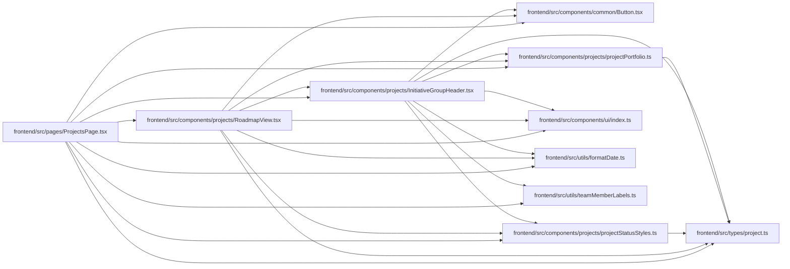

# InitiativeGroupHeader Module

**Path:** `frontend/src/components/projects/InitiativeGroupHeader.tsx`

## Description

_Auto-generated from `frontend/src/components/projects/InitiativeGroupHeader.tsx`._

## Imports

| Source | Symbols | Type-only | Runtime emission |
|--------|---------|-----------|------------------|
| `../../types/project` | `ProjectHealth` | Declaration | erased |
| `../../utils/formatDate` | `formatDate` | — | compiler-dependent |
| `../../utils/teamMemberLabels` | `formatPortfolioOwnerLabel` | — | compiler-dependent |
| `../common/Button` | `Button` | — | compiler-dependent |
| `../ui` | `OverflowMenu` | — | compiler-dependent |
| `./projectPortfolio` | `InitiativeGroupInfo` | Declaration | erased |
| `./projectStatusStyles` | `projectHealthBadgeClassName` | — | compiler-dependent |
| `clsx` | `clsx` | — | compiler-dependent |
| `lucide-react` | `Pencil` | — | compiler-dependent |
| `react` | `useId` | — | compiler-dependent |
| `react-i18next` | `useTranslation` | — | compiler-dependent |

## Module Signals

| Signal | Values |
|--------|--------|
| Exports | `InitiativeGroupHeader` |
| Constants | `healthLabelKeys` |

## Local dependency map

<!-- Auto-generated local dependency summary. Do not edit by hand. -->
This graph shows full source coupling. Type dependencies can be erased; compiler-dependent cycle groups are runtime candidates, not confirmed initialization cycles.

### Internal neighbors

| Direction | Module |
|---|---|
| Inbound | [RoadmapView](../modules/RoadmapView.md) |
| Inbound | [ProjectsPage](../modules/ProjectsPage.md) |
| Outbound | [Button](../modules/Button.md) |
| Outbound | [projectPortfolio](../modules/projectPortfolio.md) |
| Outbound | [projectStatusStyles](../modules/projectStatusStyles.md) |
| Outbound | [index](../modules/index.md) |
| Outbound | [types_project](../modules/types_project.md) |
| Outbound | [formatDate](../modules/formatDate.md) |
| Outbound | [teamMemberLabels](../modules/teamMemberLabels.md) |

### External packages

| Language | Used packages | Undeclared packages |
|---|---:|---:|
| typescript | 4 | 0 |

## Functions

| Function | Signature | Decorators | Description |
|----------|-----------|------------|-------------|
| `InitiativeGroupHeader` | <pre><code>&#40;&#123;&#10;    initiative&#44;&#10;    projectCount&#44;&#10;    headingLevel&#44;&#10;    headingId&#44;&#10;    onEdit&#44;&#10;    onDelete&#44;&#10;    className&#44;&#10;&#125;&#58; &#123;&#10;    initiative&#58; InitiativeGroupInfo &#124; null&#59;&#10;    projectCount&#58; number&#59;&#10;    &#47;&#42;&#42; A heading in the roadmap rail&#59; plain text inside a table header cell&#46; &#42;&#47;&#10;    headingLevel&#63;&#58; 3&#59;&#10;    headingId&#63;&#58; string&#59;&#10;    onEdit&#63;&#58; &#40;&#41; &#61;&#62; void&#59;&#10;    onDelete&#63;&#58; &#40;&#41; &#61;&#62; void&#59;&#10;    className&#63;&#58; string&#59;&#10;&#125;&#41;</code></pre> | — | The header row of one initiative group: its name, owner, health and target |
