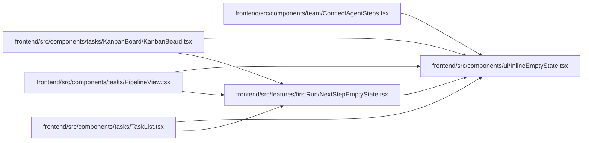

# InlineEmptyState Module

**Path:** `frontend/src/components/ui/InlineEmptyState.tsx`

## Description

_Auto-generated from `frontend/src/components/ui/InlineEmptyState.tsx`._

## Imports

| Source | Symbols | Type-only | Runtime emission |
|--------|---------|-----------|------------------|
| `clsx` | `clsx` | — | compiler-dependent |
| `react` | `ReactNode` | Declaration | erased |

## Module Signals

| Signal | Values |
|--------|--------|
| Exports | `InlineEmptyState` |

## Local dependency map

<!-- Auto-generated local dependency summary. Do not edit by hand. -->

### Internal neighbors

| Direction | Module |
|---|---|
| Inbound | [KanbanBoard](../modules/KanbanBoard.md) |
| Inbound | [PipelineView](../modules/PipelineView.md) |
| Inbound | [TaskList](../modules/TaskList.md) |
| Inbound | [ConnectAgentSteps](../modules/ConnectAgentSteps.md) |
| Inbound | [NextStepEmptyState](../modules/NextStepEmptyState.md) |

### External packages

| Language | Used packages | Undeclared packages |
|---|---:|---:|
| typescript | 2 | 0 |

## Functions

| Function | Signature | Decorators | Description |
|----------|-----------|------------|-------------|
| `InlineEmptyState` | <pre><code>&#40;&#123;&#10;    icon&#44;&#10;    title&#44;&#10;    description&#44;&#10;    actions&#44;&#10;    children&#44;&#10;    className&#44;&#10;    headingLevel &#61; 3&#44;&#10;&#125;&#58; &#123;&#10;    icon&#63;&#58; ReactNode&#59;&#10;    title&#63;&#58; ReactNode&#59;&#10;    description&#63;&#58; ReactNode&#59;&#10;    actions&#63;&#58; ReactNode&#59;&#10;    children&#63;&#58; ReactNode&#59;&#10;    className&#63;&#58; string&#59;&#10;    &#47;&#42;&#42; The level of the title heading&#58; 2 under a page heading that has no section yet&#46; &#42;&#47;&#10;    headingLevel&#63;&#58; 2 &#124; 3&#59;&#10;&#125;&#41;</code></pre> | — | — |
