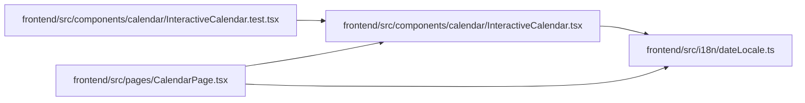

# InteractiveCalendar Module

**Path:** `frontend/src/components/calendar/InteractiveCalendar.tsx`

## Description

_Auto-generated from `frontend/src/components/calendar/InteractiveCalendar.tsx`._

## Imports

| Source | Symbols | Type-only | Runtime emission |
|--------|---------|-----------|------------------|
| `../../i18n/dateLocale` | `dateFnsLocale` | — | compiler-dependent |
| `clsx` | `clsx` | — | compiler-dependent |
| `date-fns` | `format`, `startOfMonth`, `endOfMonth`, `eachDayOfInterval`, `getDay` | — | compiler-dependent |
| `lucide-react` | `ChevronLeft`, `ChevronRight` | — | compiler-dependent |
| `react` | `useRef`, `useState` | — | compiler-dependent |
| `react-i18next` | `useTranslation` | — | compiler-dependent |

## Module Signals

| Signal | Values |
|--------|--------|
| Exports | `CalendarPeriodNavigator`, `InteractiveCalendar` |

## Local dependency map

<!-- Auto-generated local dependency summary. Do not edit by hand. -->

### Internal neighbors

| Direction | Module |
|---|---|
| Inbound | [InteractiveCalendar.test](../modules/InteractiveCalendar.test.md) |
| Inbound | [CalendarPage](../modules/CalendarPage.md) |
| Outbound | [dateLocale](../modules/dateLocale.md) |

### External packages

| Language | Used packages | Undeclared packages |
|---|---:|---:|
| typescript | 5 | 0 |

## Classes

| Class | Kind | Line | Bases / Target | Description |
|-------|------|------|----------------|-------------|
| [CalendarPeriodNavigatorProps](../entities/CalendarPeriodNavigatorProps.md) | Interface | 11 | — | — |
| [InteractiveCalendarProps](../entities/InteractiveCalendarProps.md) | Interface | 21 | — | — |

## Functions

| Function | Signature | Decorators | Description |
|----------|-----------|------------|-------------|
| `CalendarPeriodNavigator` | <pre><code>&#40;&#123;&#10;    year&#44;&#10;    month&#44;&#10;    holidays&#44;&#10;    weekendDays&#44;&#10;    onYearChange&#44;&#10;    onMonthChange&#44;&#10;    className&#44;&#10;&#125;&#58; CalendarPeriodNavigatorProps&#41;</code></pre> | — | — |
| `InteractiveCalendar` | <pre><code>&#40;&#123;&#10;    year&#44;&#10;    month&#44;&#10;    holidays&#44;&#10;    shortDays&#44;&#10;    weekendDays&#44;&#10;    onYearChange&#44;&#10;    onMonthChange&#44;&#10;    onAddHoliday&#44;&#10;    onRemoveHoliday&#44;&#10;    onAddShortDay&#44;&#10;    onRemoveShortDay&#10;&#125;&#58; InteractiveCalendarProps&#41;</code></pre> | — | — |
