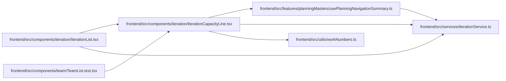

# IterationCapacityLine Module

**Path:** `frontend/src/components/iteration/IterationCapacityLine.tsx`

## Description

_Auto-generated from `frontend/src/components/iteration/IterationCapacityLine.tsx`._

## Imports

| Source | Symbols | Type-only | Runtime emission |
|--------|---------|-----------|------------------|
| `../../features/planningMasters/usePlanningNavigationSummary` | `planningNavigationSummaryKey` | — | compiler-dependent |
| `../../services/iterationService` | `iterationService` | — | compiler-dependent |
| `../../utils/workNumbers` | `formatDecimal` | — | compiler-dependent |
| `@tanstack/react-query` | `useQuery` | — | compiler-dependent |
| `react-i18next` | `useTranslation` | — | compiler-dependent |

## Module Signals

| Signal | Values |
|--------|--------|
| Exports | `IterationCapacityLine` |

## Local dependency map

<!-- Auto-generated local dependency summary. Do not edit by hand. -->

### Internal neighbors

| Direction | Module |
|---|---|
| Inbound | [IterationList](../modules/IterationList.md) |
| Inbound | [TeamList.test](../modules/TeamList.test.md) |
| Outbound | [usePlanningNavigationSummary](../modules/usePlanningNavigationSummary.md) |
| Outbound | [iterationService](../modules/iterationService.md) |
| Outbound | [workNumbers](../modules/workNumbers.md) |

### External packages

| Language | Used packages | Undeclared packages |
|---|---:|---:|
| typescript | 2 | 0 |

## Functions

| Function | Signature | Decorators | Description |
|----------|-----------|------------|-------------|
| `IterationCapacityLine` | `({ iterationId }: { iterationId: number })` | — | One labelled capacity bar per iteration: planned hours against capacity, tasks, and whether a schedule exists. |
