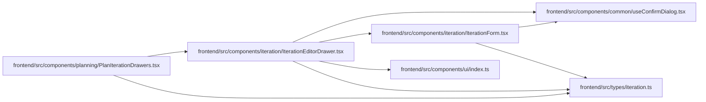

# IterationEditorDrawer Module

**Path:** `frontend/src/components/iteration/IterationEditorDrawer.tsx`

## Description

_Auto-generated from `frontend/src/components/iteration/IterationEditorDrawer.tsx`._

## Imports

| Source | Symbols | Type-only | Runtime emission |
|--------|---------|-----------|------------------|
| `../../types/iteration` | `Iteration` | Declaration | erased |
| `../common/useConfirmDialog` | `useConfirmDialog` | — | compiler-dependent |
| `../ui` | `SlideOverDrawer` | — | compiler-dependent |
| `./IterationForm` | `IterationForm` | — | compiler-dependent |
| `react` | `useState` | — | compiler-dependent |
| `react-i18next` | `useTranslation` | — | compiler-dependent |

## Module Signals

| Signal | Values |
|--------|--------|
| Exports | `IterationEditorDrawer` |

## Local dependency map

<!-- Auto-generated local dependency summary. Do not edit by hand. -->
This graph shows full source coupling. Type dependencies can be erased; compiler-dependent cycle groups are runtime candidates, not confirmed initialization cycles.

### Internal neighbors

| Direction | Module |
|---|---|
| Inbound | [PlanIterationDrawers](../modules/PlanIterationDrawers.md) |
| Outbound | [useConfirmDialog](../modules/useConfirmDialog.md) |
| Outbound | [IterationForm](../modules/IterationForm.md) |
| Outbound | [index](../modules/index.md) |
| Outbound | [types_iteration](../modules/types_iteration.md) |

### External packages

| Language | Used packages | Undeclared packages |
|---|---:|---:|
| typescript | 2 | 0 |

## Classes

| Class | Kind | Line | Bases / Target | Description |
|-------|------|------|----------------|-------------|
| [IterationEditorDrawerProps](../entities/IterationEditorDrawerProps.md) | Interface | 8 | — | — |

## Functions

| Function | Signature | Decorators | Description |
|----------|-----------|------------|-------------|
| `IterationEditorDrawer` | `({ iteration, defaultProjectId, onClose, onSaved }: IterationEditorDrawerProps)` | — | The iteration form in the slide-over drawer, the one place an iteration is created or edited. |
