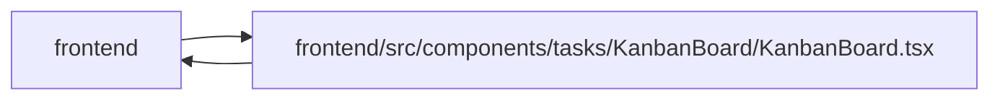

# KanbanBoard Module

**Path:** `frontend/src/components/tasks/KanbanBoard/KanbanBoard.tsx`

## Description

_Auto-generated from `frontend/src/components/tasks/KanbanBoard/KanbanBoard.tsx`._

## Imports

| Source | Symbols | Type-only | Runtime emission |
|--------|---------|-----------|------------------|
| `../../../features/mutationFeedback` | `MutationFeedbackMeta` | Declaration | erased |
| `../../../features/mutationFeedback` | `feedbackMessage` | — | compiler-dependent |
| `../../../services/labelService` | `labelService` | — | compiler-dependent |
| `../../../services/taskService` | `taskService` | — | compiler-dependent |
| `../../../services/teamService` | `teamService` | — | compiler-dependent |
| `../../../types/task` | `Task`, `TaskBatchUpdateResponse`, `TaskStatus`, `TaskUpdate` | Declaration | erased |
| `../../../utils/graphLimitError` | `isGraphLimitError` | — | compiler-dependent |
| `../../../utils/visibleWork` | `selectVisibleWork` | — | compiler-dependent |
| `../../common/Button` | `Button` | — | compiler-dependent |
| `../../common/Modal` | `Modal` | — | compiler-dependent |
| `../../feedback/QueryState` | `QueryErrorState`, `QueryLoadingState` | — | compiler-dependent |
| `../../feedback/WorkFreshness` | `WorkFreshness` | — | compiler-dependent |
| `../../ui/tone` | `STATUS_TONE` | — | compiler-dependent |
| `../PagedTaskBrowser` | `PagedTaskBrowser` | — | compiler-dependent |
| `../TaskEditorDrawer` | `TaskEditorDrawer` | — | compiler-dependent |
| `../TaskFiltersBar` | `TaskFilters` | Declaration | erased |
| `./KanbanCard` | `KanbanCard` | — | compiler-dependent |
| `./KanbanColumn` | `KanbanColumn` | — | compiler-dependent |
| `@dnd-kit/core` | `DragStartEvent`, `DragEndEvent` | Declaration | erased |
| `@dnd-kit/core` | `DndContext`, `closestCorners`, `KeyboardSensor`, `PointerSensor`, `useSensor`, `useSensors`, `DragOverlay`, `defaultDropAnimationSideEffects` | — | compiler-dependent |
| `@dnd-kit/sortable` | `sortableKeyboardCoordinates` | — | compiler-dependent |
| `@tanstack/react-query` | `useQuery`, `useMutation`, `useQueryClient` | — | compiler-dependent |
| `react` | `useState`, `useMemo`, `useId`, `useRef` | — | compiler-dependent |
| `react-dom` | `createPortal` | — | compiler-dependent |
| `react-i18next` | `useTranslation` | — | compiler-dependent |
| `react-router-dom` | `Link` | — | compiler-dependent |

## Module Signals

| Signal | Values |
|--------|--------|
| Exports | `KanbanBoard` |
| Constants | `COLUMNS`, `VALID_TRANSITIONS` |

## Local dependency map

<!-- Auto-generated local dependency summary. Do not edit by hand. -->
This graph shows full source coupling. Type dependencies can be erased; compiler-dependent cycle groups are runtime candidates, not confirmed initialization cycles.

> Module-level dependencies exceed the generated-diagram limits, so the diagram and table below group them by top-level package. Counts report the number of module neighbors in each package.

### Internal neighbors

| Direction | Module |
|---|---|
| Inbound | `frontend` (2) |
| Outbound | `frontend` (17) |

### External packages

| Language | Used packages | Undeclared packages |
|---|---:|---:|
| typescript | 7 | 0 |

> All 19 module neighbor(s) are summarized by package because the module-level view exceeds the 12-node limit.

## Classes

| Class | Kind | Line | Bases / Target | Description |
|-------|------|------|----------------|-------------|
| [KanbanBoardProps](../entities/KanbanBoardProps.md) | Interface | 37 | — | — |
| [ColumnId](../entities/ColumnId.md) | Type alias | 42 | `'planned-unassigned' \| 'planned-assigned' \| 'active' \| 'resolved' \| 'closed'` | — |
| [BoardTaskUpdate](../entities/BoardTaskUpdate.md) | Type alias | 60 | <pre><code>Pick&#60;TaskUpdate&#44; &#39;assignee&#95;id&#39;&#62; &#38; &#123;&#10;    status&#63;&#58; TaskStatus&#59;&#10;&#125;</code></pre> | — |
| [OwnershipSelection](../entities/OwnershipSelection.md) | Type alias | 64 | <pre><code>&#123;&#10;    task&#58; Task&#59;&#10;    updates&#58; BoardTaskUpdate&#59;&#10;    targetColumn&#58; ColumnId&#59;&#10;&#125;</code></pre> | — |

## Functions

| Function | Signature | Decorators | Description |
|----------|-----------|------------|-------------|
| `KanbanBoard` | `({ iterationId, filters }: KanbanBoardProps)` | — | — |
