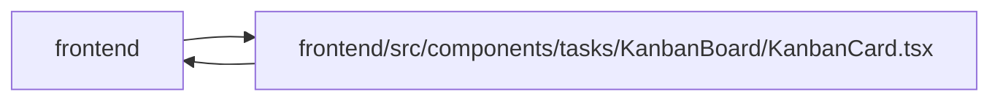

# KanbanCard Module

**Path:** `frontend/src/components/tasks/KanbanBoard/KanbanCard.tsx`

## Description

_Auto-generated from `frontend/src/components/tasks/KanbanBoard/KanbanCard.tsx`._

## Imports

| Source | Symbols | Type-only | Runtime emission |
|--------|---------|-----------|------------------|
| `../../../components/common/Button` | `Button` | — | compiler-dependent |
| `../../../types/task` | `Task` | Declaration | erased |
| `../../ui/tone` | `priorityChipClassName` | — | compiler-dependent |
| `../TaskAssigneeDisplay` | `TaskAssigneeDisplay` | — | compiler-dependent |
| `../taskRowParts` | `EffortValue`, `TaskStateChipBadge` | — | compiler-dependent |
| `../taskRowValues` | `getEffectiveEffort` | — | compiler-dependent |
| `../taskStateChip` | `taskStateChip` | — | compiler-dependent |
| `./claimTime` | `formatClaimUntil` | — | compiler-dependent |
| `@dnd-kit/sortable` | `useSortable` | — | compiler-dependent |
| `@dnd-kit/utilities` | `CSS` | — | compiler-dependent |
| `clsx` | `clsx` | — | compiler-dependent |
| `lucide-react` | `AlertCircle`, `Bot`, `GripVertical` | — | compiler-dependent |
| `react-i18next` | `useTranslation` | — | compiler-dependent |

## Module Signals

| Signal | Values |
|--------|--------|
| Exports | `BoardCardContext`, `KanbanCard` |

## Local dependency map

<!-- Auto-generated local dependency summary. Do not edit by hand. -->
This graph shows full source coupling. Type dependencies can be erased; compiler-dependent cycle groups are runtime candidates, not confirmed initialization cycles.

> Module-level dependencies exceed the generated-diagram limits, so the diagram and table below group them by top-level package. Counts report the number of module neighbors in each package.

### Internal neighbors

| Direction | Module |
|---|---|
| Inbound | `frontend` (4) |
| Outbound | `frontend` (8) |

### External packages

| Language | Used packages | Undeclared packages |
|---|---:|---:|
| typescript | 5 | 0 |

> All 12 module neighbor(s) are summarized by package because the module-level view exceeds the 12-node limit.

## Classes

| Class | Kind | Line | Bases / Target | Description |
|-------|------|------|----------------|-------------|
| [BoardCardContext](../entities/BoardCardContext.md) | Interface | 16 | — | What a card needs beyond its task: the task map the state chip reads, shared by every card on the board. |
| [KanbanCardProps](../entities/KanbanCardProps.md) | Interface | 20 | — | — |

## Functions

| Function | Signature | Decorators | Description |
|----------|-----------|------------|-------------|
| `KanbanCard` | `({ task, onOpen, context }: KanbanCardProps)` | — | One task on the board: the same title, state chip, assignee and effort a list row shows. |
