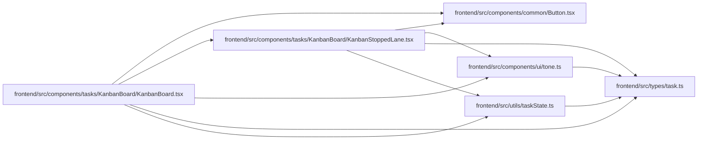

# KanbanStoppedLane Module

**Path:** `frontend/src/components/tasks/KanbanBoard/KanbanStoppedLane.tsx`

## Description

_Auto-generated from `frontend/src/components/tasks/KanbanBoard/KanbanStoppedLane.tsx`._

## Imports

| Source | Symbols | Type-only | Runtime emission |
|--------|---------|-----------|------------------|
| `../../../types/task` | `Task` | Declaration | erased |
| `../../../utils/taskState` | `stateOf` | — | compiler-dependent |
| `../../common/Button` | `Button` | — | compiler-dependent |
| `../../ui/tone` | `pillToneClassName`, `STATE_TONE` | — | compiler-dependent |
| `clsx` | `clsx` | — | compiler-dependent |
| `lucide-react` | `ChevronDown`, `ChevronRight` | — | compiler-dependent |
| `react` | `useId`, `useState` | — | compiler-dependent |
| `react-i18next` | `useTranslation` | — | compiler-dependent |

## Module Signals

| Signal | Values |
|--------|--------|
| Exports | `KanbanStoppedLane` |

## Local dependency map

<!-- Auto-generated local dependency summary. Do not edit by hand. -->
This graph shows full source coupling. Type dependencies can be erased; compiler-dependent cycle groups are runtime candidates, not confirmed initialization cycles.

### Internal neighbors

| Direction | Module |
|---|---|
| Inbound | [KanbanBoard](../modules/KanbanBoard.md) |
| Outbound | [Button](../modules/Button.md) |
| Outbound | [tone](../modules/tone.md) |
| Outbound | [types_task](../modules/types_task.md) |
| Outbound | [taskState](../modules/taskState.md) |

### External packages

| Language | Used packages | Undeclared packages |
|---|---:|---:|
| typescript | 4 | 0 |

## Classes

| Class | Kind | Line | Bases / Target | Description |
|-------|------|------|----------------|-------------|
| [KanbanStoppedLaneProps](../entities/KanbanStoppedLaneProps.md) | Interface | 10 | — | — |

## Functions

| Function | Signature | Decorators | Description |
|----------|-----------|------------|-------------|
| `KanbanStoppedLane` | `({ kind, tasks, defaultOpen = false, onOpen, onOpenTask }: KanbanStoppedLaneProps)` | — | Work that is not in a board column: postponed work waiting to return, and canceled or superseded work that has |
