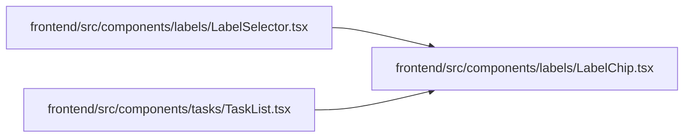

# LabelChip Module

**Path:** `frontend/src/components/labels/LabelChip.tsx`

## Description

_Auto-generated from `frontend/src/components/labels/LabelChip.tsx`._

## Imports

| Source | Symbols | Type-only | Runtime emission |
|--------|---------|-----------|------------------|
| `clsx` | `clsx` | — | compiler-dependent |
| `react` | `ReactNode` | Declaration | erased |

## Module Signals

| Signal | Values |
|--------|--------|
| Exports | `LabelChip` |

## Local dependency map

<!-- Auto-generated local dependency summary. Do not edit by hand. -->

### Internal neighbors

| Direction | Module |
|---|---|
| Inbound | [LabelSelector](../modules/LabelSelector.md) |
| Inbound | [TaskList](../modules/TaskList.md) |

### External packages

| Language | Used packages | Undeclared packages |
|---|---:|---:|
| typescript | 2 | 0 |

## Functions

| Function | Signature | Decorators | Description |
|----------|-----------|------------|-------------|
| `LabelChip` | `({ color, children, size = 'sm' }: { color?: string \| null; children: ReactNode; size?: 'sm' \| 'md' })` | — | A label is an attribute, not a state: a neutral chip with the label's own |
