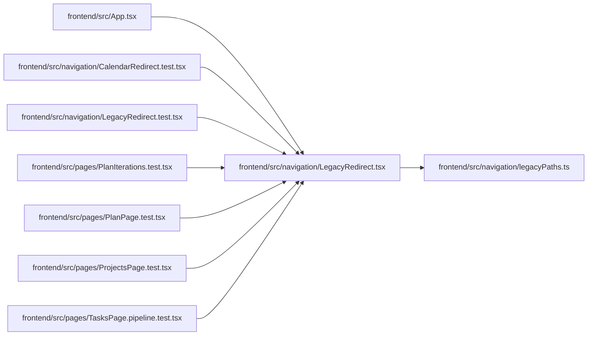

# LegacyRedirect Module

**Path:** `frontend/src/navigation/LegacyRedirect.tsx`

## Description

_Auto-generated from `frontend/src/navigation/LegacyRedirect.tsx`._

## Imports

| Source | Symbols | Type-only | Runtime emission |
|--------|---------|-----------|------------------|
| `./legacyPaths` | `mapLegacyPath` | — | compiler-dependent |
| `react` | `ReactNode` | Declaration | erased |
| `react-router-dom` | `Navigate`, `useLocation` | — | compiler-dependent |

## Module Signals

| Signal | Values |
|--------|--------|
| Exports | `LegacyRedirect` |

## Local dependency map

<!-- Auto-generated local dependency summary. Do not edit by hand. -->

### Internal neighbors

| Direction | Module |
|---|---|
| Inbound | [App](../modules/App.md) |
| Inbound | [CalendarRedirect.test](../modules/CalendarRedirect.test.md) |
| Inbound | [LegacyRedirect.test](../modules/LegacyRedirect.test.md) |
| Inbound | [PlanIterations.test](../modules/PlanIterations.test.md) |
| Inbound | [PlanPage.test](../modules/PlanPage.test.md) |
| Inbound | [ProjectsPage.test](../modules/ProjectsPage.test.md) |
| Inbound | [TasksPage.pipeline.test](../modules/TasksPage.pipeline.test.md) |
| Outbound | [legacyPaths](../modules/legacyPaths.md) |

### External packages

| Language | Used packages | Undeclared packages |
|---|---:|---:|
| typescript | 2 | 0 |

## Functions

| Function | Signature | Decorators | Description |
|----------|-----------|------------|-------------|
| `LegacyRedirect` | `({ children }: { children?: ReactNode })` | — | — |
