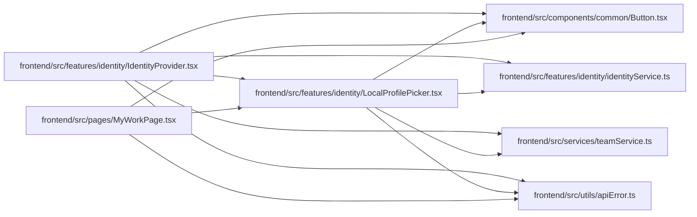

# LocalProfilePicker Module

**Path:** `frontend/src/features/identity/LocalProfilePicker.tsx`

## Description

Lets a trusted-local browser choose the person profile it works as, or add one with only a name ("Add me"), and clear the choice. It lists person profiles only, saves through `PUT /auth/local-profile`, and calls `onChosen` so the identity is re-read. Used by the account menu in `IdentityProvider.tsx` and by My Work when the queue has no profile. The choice is a label for that browser's queue, never a verified identity.

## Imports

| Source | Symbols | Type-only | Runtime emission |
|--------|---------|-----------|------------------|
| `../../components/common/Button` | `Button` | — | compiler-dependent |
| `../../services/teamService` | `teamService` | — | compiler-dependent |
| `../../utils/apiError` | `getApiErrorMessage` | — | compiler-dependent |
| `./identityService` | `WorkProfile` | Declaration | erased |
| `./identityService` | `identityService` | — | compiler-dependent |
| `@tanstack/react-query` | `useMutation`, `useQuery` | — | compiler-dependent |
| `react` | `FormEvent` | Declaration | erased |
| `react` | `useId`, `useRef`, `useState` | — | compiler-dependent |
| `react-i18next` | `useTranslation` | — | compiler-dependent |

## Module Signals

| Signal | Values |
|--------|--------|
| Exports | `LocalProfilePicker` |

## Local dependency map

<!-- Auto-generated local dependency summary. Do not edit by hand. -->
This graph shows full source coupling. Type dependencies can be erased; compiler-dependent cycle groups are runtime candidates, not confirmed initialization cycles.

### Internal neighbors

| Direction | Module |
|---|---|
| Inbound | [IdentityProvider](../modules/IdentityProvider.md) |
| Inbound | [MyWorkPage](../modules/MyWorkPage.md) |
| Outbound | [Button](../modules/Button.md) |
| Outbound | [identityService](../modules/identityService.md) |
| Outbound | [teamService](../modules/teamService.md) |
| Outbound | [apiError](../modules/apiError.md) |

### External packages

| Language | Used packages | Undeclared packages |
|---|---:|---:|
| typescript | 3 | 0 |

## Functions

| Function | Signature | Decorators | Description |
|----------|-----------|------------|-------------|
| `LocalProfilePicker` | `({ current, onChosen }: { current: WorkProfile \| null; onChosen: () => void })` | — | Lets a trusted-local session say which person it works as. The choice is |