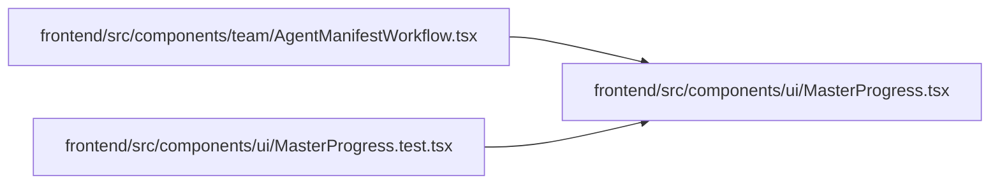

# MasterProgress Module

**Path:** `frontend/src/components/ui/MasterProgress.tsx`

## Description

_Auto-generated from `frontend/src/components/ui/MasterProgress.tsx`._

## Module Signals

| Signal | Values |
|--------|--------|
| Exports | `MasterProgress` |

## Local dependency map

<!-- Auto-generated local dependency summary. Do not edit by hand. -->

### Internal neighbors

| Direction | Module |
|---|---|
| Inbound | [AgentManifestWorkflow](../modules/AgentManifestWorkflow.md) |
| Inbound | [MasterProgress.test](../modules/MasterProgress.test.md) |

## Classes

| Class | Kind | Line | Bases / Target | Description |
|-------|------|------|----------------|-------------|
| [MasterProgressProps](../entities/MasterProgressProps.md) | Interface | 1 | — | — |

## Functions

| Function | Signature | Decorators | Description |
|----------|-----------|------------|-------------|
| `MasterProgress` | <pre><code>&#40;&#123;&#10;    className &#61; &#39;&#39;&#44;&#10;    completed&#44;&#10;    label&#44;&#10;    total&#44;&#10;    valueText&#44;&#10;&#125;&#58; MasterProgressProps&#41;</code></pre> | — | — |
