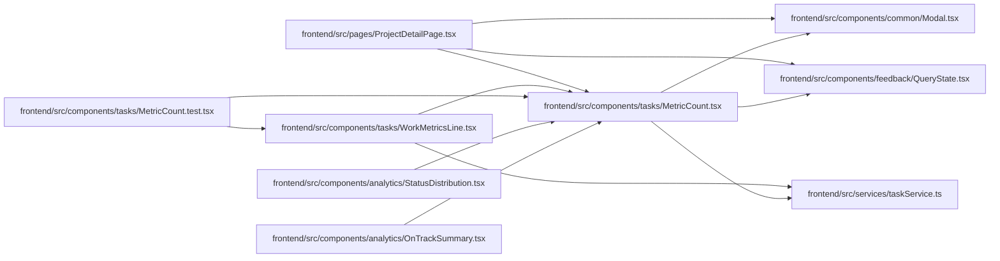

# MetricCount Module

**Path:** `frontend/src/components/tasks/MetricCount.tsx`

## Description

_Auto-generated from `frontend/src/components/tasks/MetricCount.tsx`._

## Imports

| Source | Symbols | Type-only | Runtime emission |
|--------|---------|-----------|------------------|
| `../../services/taskService` | `MetricScope`, `WorkMetricName` | Declaration | erased |
| `../../services/taskService` | `taskService` | — | compiler-dependent |
| `../common/Modal` | `Modal` | — | compiler-dependent |
| `../feedback/QueryState` | `QueryErrorState` | — | compiler-dependent |
| `@tanstack/react-query` | `useQuery` | — | compiler-dependent |
| `react` | `ReactNode` | Declaration | erased |
| `react` | `useState` | — | compiler-dependent |
| `react-i18next` | `useTranslation` | — | compiler-dependent |
| `react-router-dom` | `Link` | — | compiler-dependent |

## Module Signals

| Signal | Values |
|--------|--------|
| Exports | `MetricCount` |

## Local dependency map

<!-- Auto-generated local dependency summary. Do not edit by hand. -->
This graph shows full source coupling. Type dependencies can be erased; compiler-dependent cycle groups are runtime candidates, not confirmed initialization cycles.

### Internal neighbors

| Direction | Module |
|---|---|
| Inbound | [OnTrackSummary](../modules/OnTrackSummary.md) |
| Inbound | [StatusDistribution](../modules/StatusDistribution.md) |
| Inbound | [MetricCount.test](../modules/MetricCount.test.md) |
| Inbound | [WorkMetricsLine](../modules/WorkMetricsLine.md) |
| Inbound | [ProjectDetailPage](../modules/ProjectDetailPage.md) |
| Outbound | [Modal](../modules/Modal.md) |
| Outbound | [QueryState](../modules/QueryState.md) |
| Outbound | [taskService](../modules/taskService.md) |

### External packages

| Language | Used packages | Undeclared packages |
|---|---:|---:|
| typescript | 4 | 0 |

## Functions

| Function | Signature | Decorators | Description |
|----------|-----------|------------|-------------|
| `MetricCount` | <pre><code>&#40;&#123; metric&#44; scope&#44; title&#44; children&#44; className &#125;&#58; &#123;&#10;    metric&#58; WorkMetricName&#59; scope&#58; MetricScope &#124; null&#59; title&#58; string&#59; children&#58; ReactNode&#59; className&#63;&#58; string&#59;&#10;&#125;&#41;</code></pre> | — | A count that opens the tasks it counts. The server picks them with the same |
