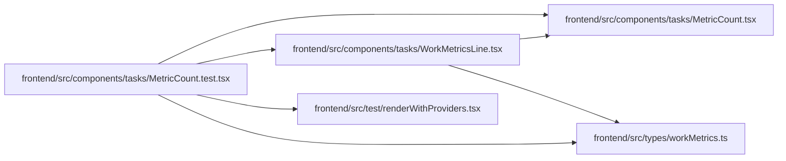

# MetricCount.test Module

**Path:** `frontend/src/components/tasks/MetricCount.test.tsx`

## Description

_Auto-generated from `frontend/src/components/tasks/MetricCount.test.tsx`._

## Imports

| Source | Symbols | Type-only | Runtime emission |
|--------|---------|-----------|------------------|
| `../../test/renderWithProviders` | `renderWithProviders` | — | compiler-dependent |
| `../../types/workMetrics` | `WorkMetrics` | Declaration | erased |
| `./MetricCount` | `MetricCount` | — | compiler-dependent |
| `./WorkMetricsLine` | `WorkMetricsLine` | — | compiler-dependent |
| `@testing-library/react` | `screen`, `within` | — | compiler-dependent |
| `vitest` | `describe`, `expect`, `it`, `vi` | — | compiler-dependent |

## Module Signals

| Signal | Values |
|--------|--------|
| Constants | `service` |
| Module calls | `service = hoisted`, `mock`, `describe` |

## Local dependency map

<!-- Auto-generated local dependency summary. Do not edit by hand. -->
This graph shows full source coupling. Type dependencies can be erased; compiler-dependent cycle groups are runtime candidates, not confirmed initialization cycles.

### Internal neighbors

| Direction | Module |
|---|---|
| Outbound | [MetricCount](../modules/MetricCount.md) |
| Outbound | [WorkMetricsLine](../modules/WorkMetricsLine.md) |
| Outbound | [renderWithProviders](../modules/renderWithProviders.md) |
| Outbound | [workMetrics](../modules/workMetrics.md) |

### External packages

| Language | Used packages | Undeclared packages |
|---|---:|---:|
| typescript | 2 | 0 |
