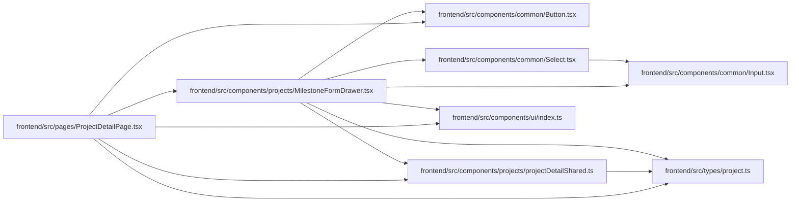

# MilestoneFormDrawer Module

**Path:** `frontend/src/components/projects/MilestoneFormDrawer.tsx`

## Description

_Auto-generated from `frontend/src/components/projects/MilestoneFormDrawer.tsx`._

## Imports

| Source | Symbols | Type-only | Runtime emission |
|--------|---------|-----------|------------------|
| `../../components/common/Select` | `Select` | — | compiler-dependent |
| `../../types/project` | `ProjectMilestoneStatus` | Declaration | erased |
| `../common/Button` | `Button` | — | compiler-dependent |
| `../common/Input` | `RequiredIndicator` | — | compiler-dependent |
| `../ui` | `SlideOverDrawer` | — | compiler-dependent |
| `./projectDetailShared` | `MilestoneFormState` | Specifier | compiler-dependent |
| `./projectDetailShared` | `milestoneStatusLabelKeys`, `t`, `textareaClassName` | — | compiler-dependent |
| `clsx` | `clsx` | — | compiler-dependent |
| `react` | `FormEvent` | Declaration | erased |

## Module Signals

| Signal | Values |
|--------|--------|
| Exports | `MilestoneFormDrawer` |

## Local dependency map

<!-- Auto-generated local dependency summary. Do not edit by hand. -->
This graph shows full source coupling. Type dependencies can be erased; compiler-dependent cycle groups are runtime candidates, not confirmed initialization cycles.

### Internal neighbors

| Direction | Module |
|---|---|
| Inbound | [ProjectDetailPage](../modules/ProjectDetailPage.md) |
| Outbound | [Button](../modules/Button.md) |
| Outbound | [Input](../modules/Input.md) |
| Outbound | [Select](../modules/Select.md) |
| Outbound | [projectDetailShared](../modules/projectDetailShared.md) |
| Outbound | [index](../modules/index.md) |
| Outbound | [types_project](../modules/types_project.md) |

### External packages

| Language | Used packages | Undeclared packages |
|---|---:|---:|
| typescript | 2 | 0 |

## Functions

| Function | Signature | Decorators | Description |
|----------|-----------|------------|-------------|
| `MilestoneFormDrawer` | <pre><code>&#40;&#123;&#10;    mode&#44;&#10;    form&#44;&#10;    error&#44;&#10;    isSaving&#44;&#10;    onChange&#44;&#10;    onSubmit&#44;&#10;    onCancel&#44;&#10;&#125;&#58; &#123;&#10;    mode&#58; &#39;create&#39; &#124; &#39;edit&#39;&#59;&#10;    form&#58; MilestoneFormState&#59;&#10;    error&#58; string &#124; null&#59;&#10;    isSaving&#58; boolean&#59;&#10;    onChange&#58; &#60;K extends keyof MilestoneFormState&#62;&#40;field&#58; K&#44; value&#58; MilestoneFormState&#91;K&#93;&#41; &#61;&#62; void&#59;&#10;    onSubmit&#58; &#40;event&#58; FormEvent&#60;HTMLFormElement&#62;&#41; &#61;&#62; void&#59;&#10;    onCancel&#58; &#40;&#41; &#61;&#62; void&#59;&#10;&#125;&#41;</code></pre> | — | — |
