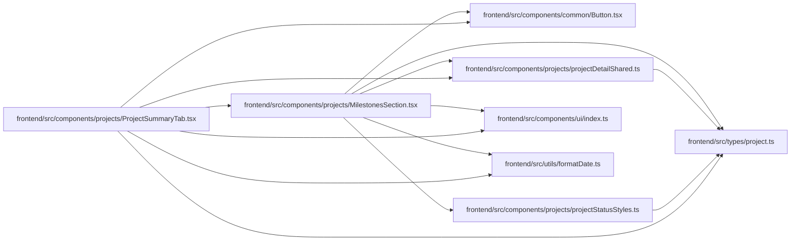

# MilestonesSection Module

**Path:** `frontend/src/components/projects/MilestonesSection.tsx`

## Description

_Auto-generated from `frontend/src/components/projects/MilestonesSection.tsx`._

## Imports

| Source | Symbols | Type-only | Runtime emission |
|--------|---------|-----------|------------------|
| `../../types/project` | `ProjectMilestone`, `ProjectMilestoneTaskGroup` | Declaration | erased |
| `../../utils/formatDate` | `formatDate` | — | compiler-dependent |
| `../common/Button` | `Button` | — | compiler-dependent |
| `../ui` | `SectionCard` | — | compiler-dependent |
| `./projectDetailShared` | `formatNumber`, `milestoneStatusLabelKeys`, `t` | — | compiler-dependent |
| `./projectStatusStyles` | `projectStatusBadgeClassName` | — | compiler-dependent |
| `clsx` | `clsx` | — | compiler-dependent |
| `lucide-react` | `ArrowDown`, `ArrowUp`, `CheckCircle2`, `Edit`, `Plus`, `Target`, `Trash2`, `XCircle` | — | compiler-dependent |

## Module Signals

| Signal | Values |
|--------|--------|
| Exports | `MilestonesSection` |

## Local dependency map

<!-- Auto-generated local dependency summary. Do not edit by hand. -->
This graph shows full source coupling. Type dependencies can be erased; compiler-dependent cycle groups are runtime candidates, not confirmed initialization cycles.

### Internal neighbors

| Direction | Module |
|---|---|
| Inbound | [ProjectSummaryTab](../modules/ProjectSummaryTab.md) |
| Outbound | [Button](../modules/Button.md) |
| Outbound | [projectDetailShared](../modules/projectDetailShared.md) |
| Outbound | [projectStatusStyles](../modules/projectStatusStyles.md) |
| Outbound | [index](../modules/index.md) |
| Outbound | [types_project](../modules/types_project.md) |
| Outbound | [formatDate](../modules/formatDate.md) |

### External packages

| Language | Used packages | Undeclared packages |
|---|---:|---:|
| typescript | 2 | 0 |

## Functions

| Function | Signature | Decorators | Description |
|----------|-----------|------------|-------------|
| `MilestonesSection` | <pre><code>&#40;&#123;&#10;    milestones&#44;&#10;    groups&#44;&#10;    isLoading&#44;&#10;    isActionPending&#44;&#10;    actionError&#44;&#10;    onCreate&#44;&#10;    onEdit&#44;&#10;    onComplete&#44;&#10;    onCancel&#44;&#10;    onDelete&#44;&#10;    onMove&#44;&#10;&#125;&#58; &#123;&#10;    milestones&#58; ProjectMilestone&#91;&#93;&#59;&#10;    groups&#58; ProjectMilestoneTaskGroup&#91;&#93;&#59;&#10;    isLoading&#58; boolean&#59;&#10;    isActionPending&#58; boolean&#59;&#10;    actionError&#58; string &#124; null&#59;&#10;    onCreate&#58; &#40;&#41; &#61;&#62; void&#59;&#10;    onEdit&#58; &#40;milestone&#58; ProjectMilestone&#41; &#61;&#62; void&#59;&#10;    onComplete&#58; &#40;milestone&#58; ProjectMilestone&#41; &#61;&#62; void&#59;&#10;    onCancel&#58; &#40;milestone&#58; ProjectMilestone&#41; &#61;&#62; void&#59;&#10;    onDelete&#58; &#40;milestone&#58; ProjectMilestone&#41; &#61;&#62; void&#59;&#10;    onMove&#58; &#40;milestoneId&#58; number&#44; direction&#58; &#45;1 &#124; 1&#41; &#61;&#62; void&#59;&#10;&#125;&#41;</code></pre> | — | — |
