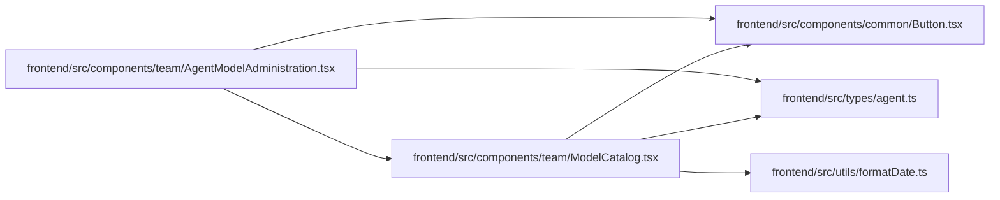

# ModelCatalog Module

**Path:** `frontend/src/components/team/ModelCatalog.tsx`

## Description

_Auto-generated from `frontend/src/components/team/ModelCatalog.tsx`._

## Imports

| Source | Symbols | Type-only | Runtime emission |
|--------|---------|-----------|------------------|
| `../../types/agent` | `AgentModelCatalogEntry` | Declaration | erased |
| `../../utils/formatDate` | `formatDateTime` | — | compiler-dependent |
| `../common/Button` | `Button` | — | compiler-dependent |
| `react-i18next` | `useTranslation` | — | compiler-dependent |

## Module Signals

| Signal | Values |
|--------|--------|
| Exports | `ModelCatalog` |

## Local dependency map

<!-- Auto-generated local dependency summary. Do not edit by hand. -->
This graph shows full source coupling. Type dependencies can be erased; compiler-dependent cycle groups are runtime candidates, not confirmed initialization cycles.

### Internal neighbors

| Direction | Module |
|---|---|
| Inbound | [AgentModelAdministration](../modules/AgentModelAdministration.md) |
| Outbound | [Button](../modules/Button.md) |
| Outbound | [types_agent](../modules/types_agent.md) |
| Outbound | [formatDate](../modules/formatDate.md) |

### External packages

| Language | Used packages | Undeclared packages |
|---|---:|---:|
| typescript | 1 | 0 |

## Functions

| Function | Signature | Decorators | Description |
|----------|-----------|------------|-------------|
| `ModelCatalog` | <pre><code>&#40;&#123; entries&#44; canAdminister&#44; busy&#44; onEdit&#44; onToggle &#125;&#58; &#123;&#10;    entries&#58; AgentModelCatalogEntry&#91;&#93;&#59; canAdminister&#58; boolean&#59; busy&#58; boolean&#59;&#10;    onEdit&#58; &#40;entry&#58; AgentModelCatalogEntry&#41; &#61;&#62; void&#59; onToggle&#58; &#40;entry&#58; AgentModelCatalogEntry&#41; &#61;&#62; void&#59;&#10;&#125;&#41;</code></pre> | — | — |
