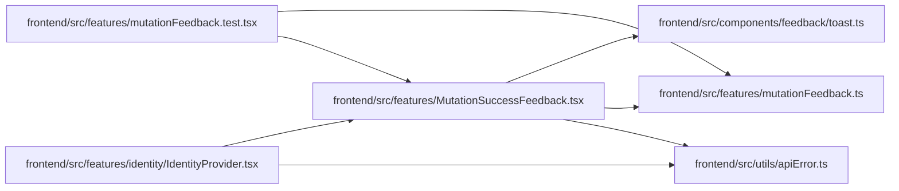

# MutationSuccessFeedback Module

**Path:** `frontend/src/features/MutationSuccessFeedback.tsx`

## Description

_Auto-generated from `frontend/src/features/MutationSuccessFeedback.tsx`._

## Imports

| Source | Symbols | Type-only | Runtime emission |
|--------|---------|-----------|------------------|
| `../components/feedback/toast` | `useToast` | — | compiler-dependent |
| `../utils/apiError` | `getApiErrorMessage` | — | compiler-dependent |
| `./mutationFeedback` | `MutationFeedbackMeta` | Declaration | erased |
| `@tanstack/react-query` | `useQueryClient` | — | compiler-dependent |
| `react` | `useEffect` | — | compiler-dependent |
| `react-i18next` | `useTranslation` | — | compiler-dependent |

## Module Signals

| Signal | Values |
|--------|--------|
| Exports | `MutationSuccessFeedback` |
| Constants | `UNDO_TOAST_MS` |

## Local dependency map

<!-- Auto-generated local dependency summary. Do not edit by hand. -->
This graph shows full source coupling. Type dependencies can be erased; compiler-dependent cycle groups are runtime candidates, not confirmed initialization cycles.

### Internal neighbors

| Direction | Module |
|---|---|
| Inbound | [IdentityProvider](../modules/IdentityProvider.md) |
| Inbound | [mutationFeedback.test](../modules/mutationFeedback.test.md) |
| Outbound | [toast](../modules/toast.md) |
| Outbound | [mutationFeedback](../modules/mutationFeedback.md) |
| Outbound | [apiError](../modules/apiError.md) |

### External packages

| Language | Used packages | Undeclared packages |
|---|---:|---:|
| typescript | 3 | 0 |

## Functions

| Function | Signature | Decorators | Description |
|----------|-----------|------------|-------------|
| `MutationSuccessFeedback` | `()` | — | Shows the success toast declared by each mutation's `meta`. Mount once inside the work query client. |
