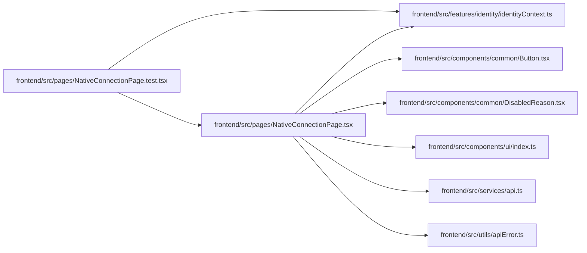

# NativeConnectionPage Module

**Path:** `frontend/src/pages/NativeConnectionPage.tsx`

## Description

Provides explicit browser consent for the Android companion. It shows the signed-in account and verification code, requires a matching-code checkbox, and resets consent when the request or principal changes. Loading, failure, retry, and approval are separate visible states.

## Imports

| Source | Symbols | Type-only | Runtime emission |
|--------|---------|-----------|------------------|
| `../components/common/Button` | `Button` | — | compiler-dependent |
| `../components/common/DisabledReason` | `DisabledReason` | — | compiler-dependent |
| `../components/ui` | `PageHeader`, `PageLayout` | — | compiler-dependent |
| `../features/identity/identityContext` | `useIdentity` | — | compiler-dependent |
| `../services/api` | `api` | — | compiler-dependent |
| `../utils/apiError` | `getApiErrorMessage` | — | compiler-dependent |
| `@tanstack/react-query` | `useQuery` | — | compiler-dependent |
| `react` | `useEffect`, `useState` | — | compiler-dependent |
| `react-i18next` | `useTranslation` | — | compiler-dependent |
| `react-router-dom` | `useSearchParams` | — | compiler-dependent |

## Module Signals

| Signal | Values |
|--------|--------|
| Exports | `default` |

## Local dependency map

<!-- Auto-generated local dependency summary. Do not edit by hand. -->

### Internal neighbors

| Direction | Module |
|---|---|
| Inbound | [NativeConnectionPage.test](../modules/NativeConnectionPage.test.md) |
| Outbound | [Button](../modules/Button.md) |
| Outbound | [DisabledReason](../modules/DisabledReason.md) |
| Outbound | [index](../modules/index.md) |
| Outbound | [identityContext](../modules/identityContext.md) |
| Outbound | [api](../modules/api.md) |
| Outbound | [apiError](../modules/apiError.md) |

### External packages

| Language | Used packages | Undeclared packages |
|---|---:|---:|
| typescript | 4 | 0 |

## Classes

| Class | Kind | Line | Bases / Target | Description |
|-------|------|------|----------------|-------------|
| [ConnectionDetails](../entities/ConnectionDetails.md) | Interface | 26 | — | — |

## Functions

| Function | Signature | Decorators | Description |
|----------|-----------|------------|-------------|
| `NativeConnectionPage` | `()` | — | — |
