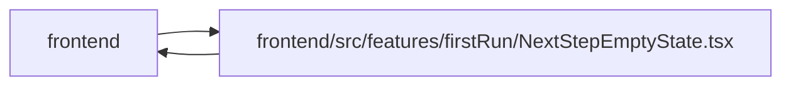

# NextStepEmptyState Module

**Path:** `frontend/src/features/firstRun/NextStepEmptyState.tsx`

## Description

_Auto-generated from `frontend/src/features/firstRun/NextStepEmptyState.tsx`._

## Imports

| Source | Symbols | Type-only | Runtime emission |
|--------|---------|-----------|------------------|
| `../../components/common/Button` | `Button` | — | compiler-dependent |
| `../../components/common/ButtonLink` | `ButtonLink` | — | compiler-dependent |
| `../../components/ui/InlineEmptyState` | `InlineEmptyState` | — | compiler-dependent |
| `./useNextSetupAction` | `NextAction` | Specifier | compiler-dependent |
| `./useNextSetupAction` | `useNextSetupAction` | — | compiler-dependent |
| `react` | `ReactNode` | Declaration | erased |

## Module Signals

| Signal | Values |
|--------|--------|
| Exports | `NextStepEmptyState` |

## Local dependency map

<!-- Auto-generated local dependency summary. Do not edit by hand. -->
This graph shows full source coupling. Type dependencies can be erased; compiler-dependent cycle groups are runtime candidates, not confirmed initialization cycles.

> Module-level dependencies exceed the generated-diagram limits, so the diagram and table below group them by top-level package. Counts report the number of module neighbors in each package.

### Internal neighbors

| Direction | Module |
|---|---|
| Inbound | `frontend` (12) |
| Outbound | `frontend` (4) |

### External packages

| Language | Used packages | Undeclared packages |
|---|---:|---:|
| typescript | 1 | 0 |

> All 16 module neighbor(s) are summarized by package because the module-level view exceeds the 12-node limit.

## Functions

| Function | Signature | Decorators | Description |
|----------|-----------|------------|-------------|
| `NextStepEmptyState` | <pre><code>&#40;&#123; title&#44; description&#44; icon&#44; className&#44; fallback&#44; onCreateProject&#44; headingLevel &#61; 2 &#125;&#58; &#123;&#10;    title&#63;&#58; ReactNode&#59;&#10;    description&#58; ReactNode&#59;&#10;    icon&#63;&#58; ReactNode&#59;&#10;    className&#63;&#58; string&#59;&#10;    fallback&#58; NextAction&#59;&#10;    onCreateProject&#63;&#58; &#40;&#41; &#61;&#62; void&#59;&#10;    headingLevel&#63;&#58; 2 &#124; 3&#59;&#10;&#125;&#41;</code></pre> | — | An empty page or view: what appears here, and the one button that fills it. The button is the |
