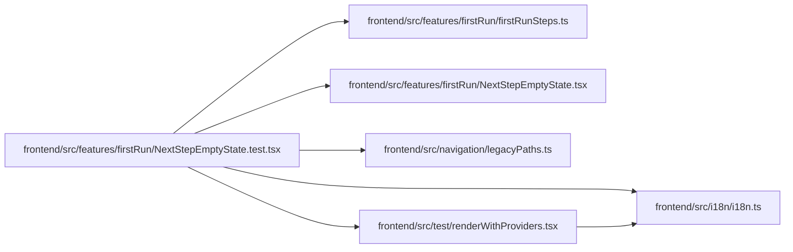

# NextStepEmptyState.test Module

**Path:** `frontend/src/features/firstRun/NextStepEmptyState.test.tsx`

## Description

_Auto-generated from `frontend/src/features/firstRun/NextStepEmptyState.test.tsx`._

## Imports

| Source | Symbols | Type-only | Runtime emission |
|--------|---------|-----------|------------------|
| `../../i18n/i18n` | `i18n` | — | compiler-dependent |
| `../../navigation/legacyPaths` | `mapLegacyPath` | — | compiler-dependent |
| `../../test/renderWithProviders` | `renderWithProviders` | — | compiler-dependent |
| `./NextStepEmptyState` | `NextStepEmptyState` | — | compiler-dependent |
| `./firstRunSteps` | `FirstRunStepId` | Specifier | compiler-dependent |
| `./firstRunSteps` | `FIRST_RUN_STEP_IDS` | — | compiler-dependent |
| `@testing-library/react` | `screen` | — | compiler-dependent |
| `@testing-library/user-event` | `userEvent` | — | compiler-dependent |
| `vitest` | `afterEach`, `describe`, `expect`, `it`, `vi` | — | compiler-dependent |

## Module Signals

| Signal | Values |
|--------|--------|
| Constants | `progress` |
| Module calls | `progress = hoisted`, `mock`, `afterEach`, `describe` |

## Local dependency map

<!-- Auto-generated local dependency summary. Do not edit by hand. -->
This graph shows full source coupling. Type dependencies can be erased; compiler-dependent cycle groups are runtime candidates, not confirmed initialization cycles.

### Internal neighbors

| Direction | Module |
|---|---|
| Outbound | [firstRunSteps](../modules/firstRunSteps.md) |
| Outbound | [NextStepEmptyState](../modules/NextStepEmptyState.md) |
| Outbound | [i18n](../modules/i18n.md) |
| Outbound | [legacyPaths](../modules/legacyPaths.md) |
| Outbound | [renderWithProviders](../modules/renderWithProviders.md) |

### External packages

| Language | Used packages | Undeclared packages |
|---|---:|---:|
| typescript | 3 | 0 |
