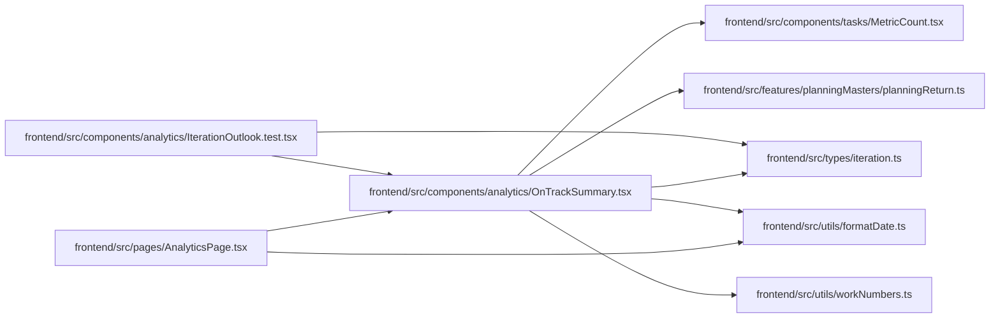

# OnTrackSummary Module

**Path:** `frontend/src/components/analytics/OnTrackSummary.tsx`

## Description

_Auto-generated from `frontend/src/components/analytics/OnTrackSummary.tsx`._

## Imports

| Source | Symbols | Type-only | Runtime emission |
|--------|---------|-----------|------------------|
| `../../features/planningMasters/planningReturn` | `planMasterStepHref` | — | compiler-dependent |
| `../../types/iteration` | `IterationSummary` | Declaration | erased |
| `../../utils/formatDate` | `formatDate` | — | compiler-dependent |
| `../../utils/workNumbers` | `formatEffortDays` | — | compiler-dependent |
| `../tasks/MetricCount` | `MetricCount` | — | compiler-dependent |
| `react-i18next` | `useTranslation` | — | compiler-dependent |
| `react-router-dom` | `Link` | — | compiler-dependent |

## Module Signals

| Signal | Values |
|--------|--------|
| Exports | `OnTrackSummary` |

## Local dependency map

<!-- Auto-generated local dependency summary. Do not edit by hand. -->
This graph shows full source coupling. Type dependencies can be erased; compiler-dependent cycle groups are runtime candidates, not confirmed initialization cycles.

### Internal neighbors

| Direction | Module |
|---|---|
| Inbound | [IterationOutlook.test](../modules/IterationOutlook.test.md) |
| Inbound | [AnalyticsPage](../modules/AnalyticsPage.md) |
| Outbound | [MetricCount](../modules/MetricCount.md) |
| Outbound | [planningReturn](../modules/planningReturn.md) |
| Outbound | [types_iteration](../modules/types_iteration.md) |
| Outbound | [formatDate](../modules/formatDate.md) |
| Outbound | [workNumbers](../modules/workNumbers.md) |

### External packages

| Language | Used packages | Undeclared packages |
|---|---:|---:|
| typescript | 2 | 0 |

## Classes

| Class | Kind | Line | Bases / Target | Description |
|-------|------|------|----------------|-------------|
| [Verdict](../entities/Verdict.md) | Type alias | 9 | `'done' \| 'noSchedule' \| 'late' \| 'atRisk' \| 'onTrack'` | — |

## Functions

| Function | Signature | Decorators | Description |
|----------|-----------|------------|-------------|
| `OnTrackSummary` | `({ summary }: { summary: IterationSummary })` | — | Answers "are we on track for the end date?" in one line, then shows why. |
