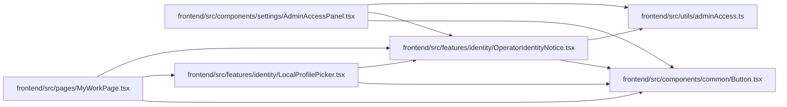

# OperatorIdentityNotice Module

**Path:** `frontend/src/features/identity/OperatorIdentityNotice.tsx`

## Description

_Auto-generated from `frontend/src/features/identity/OperatorIdentityNotice.tsx`._

## Imports

| Source | Symbols | Type-only | Runtime emission |
|--------|---------|-----------|------------------|
| `../../components/common/Button` | `Button` | — | compiler-dependent |
| `../../utils/adminAccess` | `clearAdminApiKey` | — | compiler-dependent |
| `react-i18next` | `useTranslation` | — | compiler-dependent |

## Module Signals

| Signal | Values |
|--------|--------|
| Exports | `OperatorIdentityNotice` |

## Local dependency map

<!-- Auto-generated local dependency summary. Do not edit by hand. -->

### Internal neighbors

| Direction | Module |
|---|---|
| Inbound | [AdminAccessPanel](../modules/AdminAccessPanel.md) |
| Inbound | [LocalProfilePicker](../modules/LocalProfilePicker.md) |
| Inbound | [MyWorkPage](../modules/MyWorkPage.md) |
| Outbound | [Button](../modules/Button.md) |
| Outbound | [adminAccess](../modules/adminAccess.md) |

### External packages

| Language | Used packages | Undeclared packages |
|---|---:|---:|
| typescript | 1 | 0 |

## Functions

| Function | Signature | Decorators | Description |
|----------|-----------|------------|-------------|
| `OperatorIdentityNotice` | `()` | — | — |
