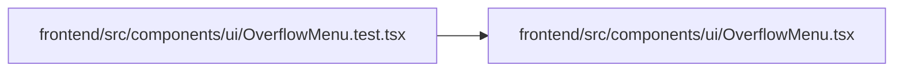

# OverflowMenu Module

**Path:** `frontend/src/components/ui/OverflowMenu.tsx`

## Description

_Auto-generated from `frontend/src/components/ui/OverflowMenu.tsx`._

## Imports

| Source | Symbols | Type-only | Runtime emission |
|--------|---------|-----------|------------------|
| `clsx` | `clsx` | — | compiler-dependent |
| `lucide-react` | `MoreHorizontal` | — | compiler-dependent |
| `react` | `KeyboardEvent`, `ReactNode` | Declaration | erased |
| `react` | `useEffect`, `useId`, `useRef`, `useState` | — | compiler-dependent |
| `react-i18next` | `useTranslation` | — | compiler-dependent |

## Module Signals

| Signal | Values |
|--------|--------|
| Exports | `OverflowMenu`, `OverflowMenuItem` |

## Local dependency map

<!-- Auto-generated local dependency summary. Do not edit by hand. -->

### Internal neighbors

| Direction | Module |
|---|---|
| Inbound | [OverflowMenu.test](../modules/OverflowMenu.test.md) |

### External packages

| Language | Used packages | Undeclared packages |
|---|---:|---:|
| typescript | 4 | 0 |

## Classes

| Class | Kind | Line | Bases / Target | Description |
|-------|------|------|----------------|-------------|
| [OverflowMenuItem](../entities/OverflowMenuItem.md) | Type alias | 7 | <pre><code>&#123;&#10;    label&#58; ReactNode&#59;&#10;    icon&#63;&#58; ReactNode&#59;&#10;    onSelect&#58; &#40;&#41; &#61;&#62; void&#59;&#10;    tone&#63;&#58; &#39;default&#39; &#124; &#39;danger&#39;&#59;&#10;    disabled&#63;&#58; boolean&#59;&#10;&#125;</code></pre> | — |

## Functions

| Function | Signature | Decorators | Description |
|----------|-----------|------------|-------------|
| `OverflowMenu` | <pre><code>&#40;&#123;&#10;    items&#44;&#10;    label&#44;&#10;    className&#44;&#10;&#125;&#58; &#123;&#10;    items&#58; OverflowMenuItem&#91;&#93;&#59;&#10;    label&#63;&#58; string&#59;&#10;    className&#63;&#58; string&#59;&#10;&#125;&#41;</code></pre> | — | — |
