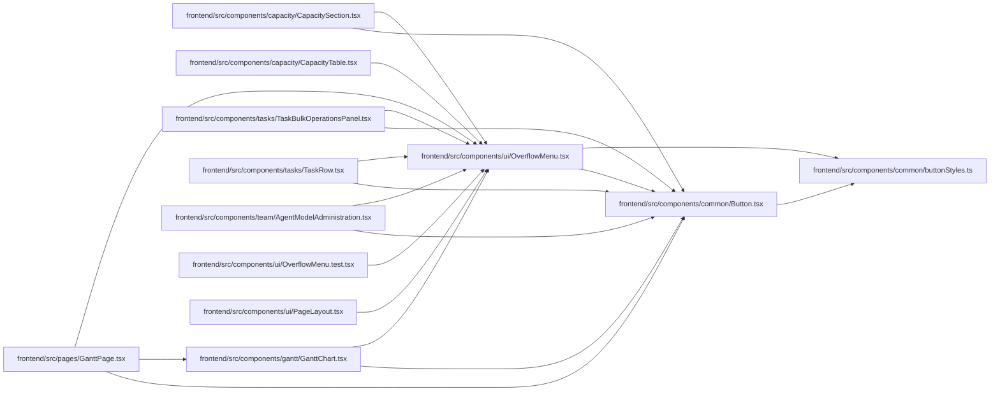

# OverflowMenu Module

**Path:** `frontend/src/components/ui/OverflowMenu.tsx`

## Description

_Auto-generated from `frontend/src/components/ui/OverflowMenu.tsx`._

## Imports

| Source | Symbols | Type-only | Runtime emission |
|--------|---------|-----------|------------------|
| `../common/Button` | `Button` | — | compiler-dependent |
| `../common/buttonStyles` | `ButtonSize`, `ButtonVariant` | Declaration | erased |
| `clsx` | `clsx` | — | compiler-dependent |
| `lucide-react` | `MoreHorizontal` | — | compiler-dependent |
| `react` | `KeyboardEvent`, `ReactNode` | Declaration | erased |
| `react` | `useEffect`, `useId`, `useRef`, `useState` | — | compiler-dependent |
| `react-i18next` | `useTranslation` | — | compiler-dependent |

## Module Signals

| Signal | Values |
|--------|--------|
| Exports | `OverflowMenu`, `OverflowMenuItem` |

## Local dependency map

<!-- Auto-generated local dependency summary. Do not edit by hand. -->
This graph shows full source coupling. Type dependencies can be erased; compiler-dependent cycle groups are runtime candidates, not confirmed initialization cycles.

### Internal neighbors

| Direction | Module |
|---|---|
| Inbound | [CapacitySection](../modules/CapacitySection.md) |
| Inbound | [CapacityTable](../modules/CapacityTable.md) |
| Inbound | [GanttChart](../modules/GanttChart.md) |
| Inbound | [TaskBulkOperationsPanel](../modules/TaskBulkOperationsPanel.md) |
| Inbound | [TaskRow](../modules/TaskRow.md) |
| Inbound | [AgentModelAdministration](../modules/AgentModelAdministration.md) |
| Inbound | [OverflowMenu.test](../modules/OverflowMenu.test.md) |
| Inbound | [PageLayout](../modules/PageLayout.md) |
| Inbound | [GanttPage](../modules/GanttPage.md) |
| Outbound | [Button](../modules/Button.md) |
| Outbound | [buttonStyles](../modules/buttonStyles.md) |

### External packages

| Language | Used packages | Undeclared packages |
|---|---:|---:|
| typescript | 4 | 0 |

## Classes

| Class | Kind | Line | Bases / Target | Description |
|-------|------|------|----------------|-------------|
| [OverflowMenuItem](../entities/OverflowMenuItem.md) | Type alias | 9 | <pre><code>&#123;&#10;    label&#58; ReactNode&#59;&#10;    icon&#63;&#58; ReactNode&#59;&#10;    onSelect&#58; &#40;&#41; &#61;&#62; void&#59;&#10;    tone&#63;&#58; &#39;default&#39; &#124; &#39;danger&#39;&#59;&#10;    disabled&#63;&#58; boolean&#59;&#10;&#125;</code></pre> | — |

## Functions

| Function | Signature | Decorators | Description |
|----------|-----------|------------|-------------|
| `OverflowMenu` | <pre><code>&#40;&#123;&#10;    items&#44;&#10;    label&#44;&#10;    className&#44;&#10;    alwaysMenu &#61; false&#44;&#10;    align &#61; &#39;end&#39;&#44;&#10;    trigger&#44;&#10;    triggerClassName&#44;&#10;    triggerVariant &#61; &#39;outline&#39;&#44;&#10;    triggerSize &#61; &#39;md&#39;&#44;&#10;    triggerIconOnly &#61; true&#44;&#10;&#125;&#58; &#123;&#10;    items&#58; OverflowMenuItem&#91;&#93;&#59;&#10;    label&#63;&#58; string&#59;&#10;    className&#63;&#58; string&#59;&#10;    &#47;&#42;&#42; Keep the menu button even for one item&#44; so a page header never gains a visible extra action&#46; &#42;&#47;&#10;    alwaysMenu&#63;&#58; boolean&#59;&#10;    &#47;&#42;&#42; Which edge of the button the menu lines up with&#46; &#42;&#47;&#10;    align&#63;&#58; &#39;start&#39; &#124; &#39;end&#39;&#59;&#10;    &#47;&#42;&#42; Replaces the three&#45;dot icon&#44; such as a status icon that opens its moves&#46; &#42;&#47;&#10;    trigger&#63;&#58; ReactNode&#59;&#10;    triggerClassName&#63;&#58; string&#59;&#10;    triggerVariant&#63;&#58; ButtonVariant&#59;&#10;    triggerSize&#63;&#58; ButtonSize&#59;&#10;    triggerIconOnly&#63;&#58; boolean&#59;&#10;&#125;&#41;</code></pre> | — | — |
