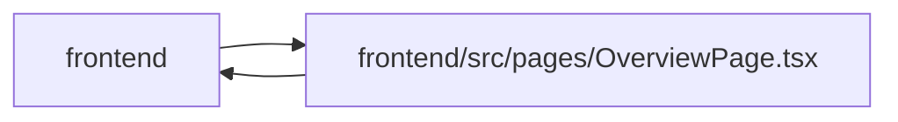

# OverviewPage Module

**Path:** `frontend/src/pages/OverviewPage.tsx`

## Description

Overview combines the selected scope’s task counts, planning signals and current work. Each data source retains its own loading, error and access state. A count opens the corresponding task list, while a task opens in a drawer with a return location.

## Imports

| Source | Symbols | Type-only | Runtime emission |
|--------|---------|-----------|------------------|
| `../components/common/Button` | `Button` | — | compiler-dependent |
| `../components/common/ButtonLink` | `ButtonLink` | — | compiler-dependent |
| `../components/feedback/QueryState` | `QueryErrorState`, `QueryLoadingState`, `QueryStaleState` | — | compiler-dependent |
| `../components/tasks/usePipeline` | `usePipeline` | — | compiler-dependent |
| `../components/ui` | `PageHeader`, `PageLayout`, `SectionCard`, `SlideOverDrawer` | — | compiler-dependent |
| `../components/ui/tone` | `PillTone` | Declaration | erased |
| `../components/ui/tone` | `STATE_TONE`, `toneSoftVar`, `toneVar` | — | compiler-dependent |
| `../features/firstRun/GetStartedPanel` | `GetStartedPanel` | — | compiler-dependent |
| `../features/firstRun/NextStepEmptyState` | `NextStepEmptyState` | — | compiler-dependent |
| `../features/firstRun/firstRunSteps` | `firstRunPlanHref` | — | compiler-dependent |
| `../features/firstRun/useGetStarted` | `useGetStarted` | — | compiler-dependent |
| `../features/overview/overviewBacklog` | `loadProjectBacklog` | — | compiler-dependent |
| `../features/overview/overviewSignals` | `AttentionCandidate`, `AttentionKind`, `OverviewCountList`, `PipelineStage` | Specifier | compiler-dependent |
| `../features/overview/overviewSignals` | `OVERVIEW_COUNT_LIST_PARAM`, `PIPELINE_STAGES`, `backlogRoots`, `daysLeftToLatestEnd`, `deliveryRisk`, `iterationsInView`, `listTasks`, `overviewCountListHref`, `parseOverviewCountList`, `pickAttention`, `pipelineStageHref`, `pipelineTasksInScope`, `selectWorkNow`, `taskListHref` | — | compiler-dependent |
| `../features/overview/overviewTaskThread` | `overviewTaskDrawerHref`, `overviewTaskReturnFocusId` | — | compiler-dependent |
| `../features/planningMasters/planningReturn` | `isPlanningStepId` | — | compiler-dependent |
| `../features/planningMasters/usePlanningNavigationSummary` | `planProgress`, `planningNavigationSummaryKey`, `usePlanningNavigationSummary` | — | compiler-dependent |
| `../features/scope/useScopeLink` | `useScopeLink` | — | compiler-dependent |
| `../features/scope/useWorkScope` | `useWorkScope` | — | compiler-dependent |
| `../features/scope/workScope` | `ScopeIteration`, `ScopeProject` | Declaration | erased |
| `../services/iterationService` | `iterationService` | — | compiler-dependent |
| `../services/projectService` | `projectService` | — | compiler-dependent |
| `../services/taskService` | `taskService` | — | compiler-dependent |
| `../types/iteration` | `Iteration` | Declaration | erased |
| `../types/task` | `Task` | Declaration | erased |
| `../utils/apiError` | `getApiErrorStatus` | — | compiler-dependent |
| `../utils/formatDate` | `formatDate` | — | compiler-dependent |
| `../utils/taskState` | `stateOf` | — | compiler-dependent |
| `../utils/workNumbers` | `formatDecimal` | — | compiler-dependent |
| `@tanstack/react-query` | `useQueries`, `useQuery` | — | compiler-dependent |
| `lucide-react` | `LucideIcon` | Declaration | erased |
| `lucide-react` | `AlertTriangle`, `ArrowRight`, `Bot`, `CheckCircle2`, `Clock`, `ClipboardCheck`, `HelpCircle`, `ListTodo`, `Plus`, `RefreshCw`, `Target`, `User`, `UserPlus` | — | compiler-dependent |
| `react` | `useEffect`, `useMemo`, `useRef`, `useState` | — | compiler-dependent |
| `react-i18next` | `useTranslation` | — | compiler-dependent |
| `react-router-dom` | `Link`, `useLocation`, `useNavigate` | — | compiler-dependent |

## Module Signals

| Signal | Values |
|--------|--------|
| Exports | `default` |
| Constants | `ATTENTION_ID`, `WORK_NOW_TITLE_ID`, `AGENTS_NOW_TITLE_ID`, `ON_TRACK_TITLE_ID`, `ATTENTION_LOOK`, `RISK_TONE` |

## Local dependency map

<!-- Auto-generated local dependency summary. Do not edit by hand. -->
This graph shows full source coupling. Type dependencies can be erased; compiler-dependent cycle groups are runtime candidates, not confirmed initialization cycles.

> Module-level dependencies exceed the generated-diagram limits, so the diagram and table below group them by top-level package. Counts report the number of module neighbors in each package.

### Internal neighbors

| Direction | Module |
|---|---|
| Inbound | `frontend` (5) |
| Outbound | `frontend` (27) |

### External packages

| Language | Used packages | Undeclared packages |
|---|---:|---:|
| typescript | 5 | 0 |

> All 32 module neighbor(s) are summarized by package because the module-level view exceeds the 12-node limit.

## Classes

| Class | Kind | Line | Bases / Target | Description |
|-------|------|------|----------------|-------------|
| [OverviewLocationState](../entities/OverviewLocationState.md) | Type alias | 76 | <pre><code>&#123;&#10;    returnFocusId&#63;&#58; string&#59;&#10;&#125;</code></pre> | — |
| [SourceState](../entities/SourceState.md) | Type alias | 84 | `'loading' \| 'failed' \| 'stale' \| 'ready' \| 'unavailable'` | Whether a source Overview needs has arrived. 'stale' means a refresh failed and the last |
| [AttentionSource](../entities/AttentionSource.md) | Type alias | 86 | `'tasks' \| 'pipeline' \| 'plan'` | — |
| [TaskGroup](../entities/TaskGroup.md) | Type alias | 97 | `{ iteration: Iteration \| null; roots: Task[] }` | The tasks Overview counts: one group per iteration in view, or the project's backlog. |
| [ListedTask](../entities/OverviewPage_ListedTask.md) | Type alias | 100 | `{ task: Task; iteration: Iteration \| null }` | A task in one of Overview's own lists, with the iteration it belongs to. |
