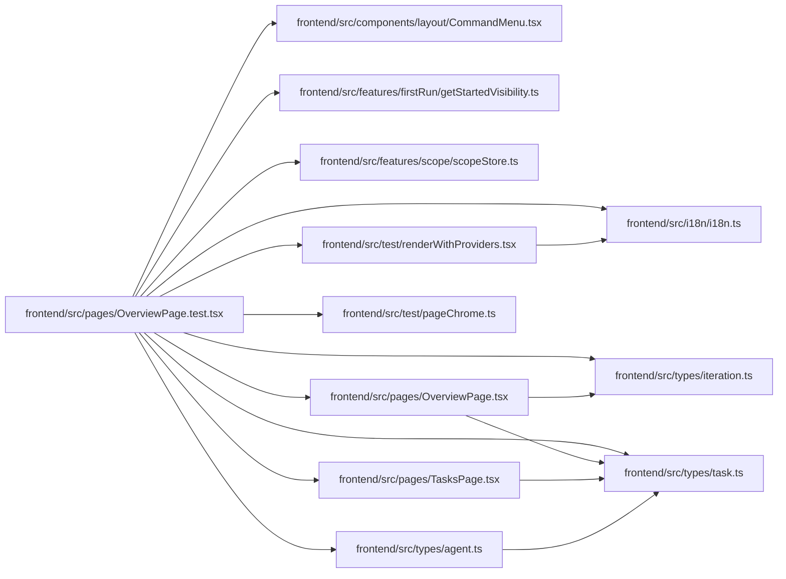

# OverviewPage.test Module

**Path:** `frontend/src/pages/OverviewPage.test.tsx`

## Description

_Auto-generated from `frontend/src/pages/OverviewPage.test.tsx`._

## Imports

| Source | Symbols | Type-only | Runtime emission |
|--------|---------|-----------|------------------|
| `../components/layout/CommandMenu` | `CommandMenu` | — | compiler-dependent |
| `../features/firstRun/getStartedVisibility` | `useGetStartedVisibility` | — | compiler-dependent |
| `../features/scope/scopeStore` | `useScopeStore` | — | compiler-dependent |
| `../i18n/i18n` | `i18n` | — | compiler-dependent |
| `../test/pageChrome` | `expectPageChrome` | — | compiler-dependent |
| `../test/renderWithProviders` | `renderWithProviders` | — | compiler-dependent |
| `../types/agent` | `AgentPipeline` | Declaration | erased |
| `../types/iteration` | `Iteration`, `PlanCheckpoint` | Declaration | erased |
| `../types/task` | `Task`, `TaskReference` | Declaration | erased |
| `./OverviewPage` | `OverviewPage` | — | compiler-dependent |
| `./TasksPage` | `TasksPage` | — | compiler-dependent |
| `@testing-library/react` | `act`, `screen`, `waitFor`, `within` | — | compiler-dependent |
| `react-router-dom` | `Route`, `Routes`, `useLocation` | — | compiler-dependent |
| `vitest` | `afterEach`, `beforeEach`, `describe`, `expect`, `it`, `vi` | — | compiler-dependent |

## Module Signals

| Signal | Values |
|--------|--------|
| Constants | `api`, `access`, `TODAY`, `ITERATIONS`, `ALPHA_TASKS`, `BETA_TASKS`, `PAST_TASKS`, `TASKS_BY_ITERATION`, `STAGES`, `BACKLOG` |
| Module calls | `api = hoisted`, `access = hoisted`, `mock`, `mock`, `mock`, `mock`, `mock`, `mock`, `mock`, `mock`, `mock`, `mock`, `mock`, `mock`, `describe` |

## Local dependency map

<!-- Auto-generated local dependency summary. Do not edit by hand. -->
This graph shows full source coupling. Type dependencies can be erased; compiler-dependent cycle groups are runtime candidates, not confirmed initialization cycles.

### Internal neighbors

| Direction | Module |
|---|---|
| Outbound | [CommandMenu](../modules/CommandMenu.md) |
| Outbound | [getStartedVisibility](../modules/getStartedVisibility.md) |
| Outbound | [scopeStore](../modules/scopeStore.md) |
| Outbound | [i18n](../modules/i18n.md) |
| Outbound | [OverviewPage](../modules/OverviewPage.md) |
| Outbound | [TasksPage](../modules/TasksPage.md) |
| Outbound | [pageChrome](../modules/pageChrome.md) |
| Outbound | [renderWithProviders](../modules/renderWithProviders.md) |
| Outbound | [types_agent](../modules/types_agent.md) |
| Outbound | [types_iteration](../modules/types_iteration.md) |
| Outbound | [types_task](../modules/types_task.md) |

### External packages

| Language | Used packages | Undeclared packages |
|---|---:|---:|
| typescript | 3 | 0 |
