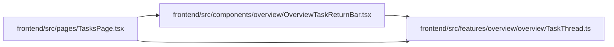

# OverviewTaskReturnBar Module

**Path:** `frontend/src/components/overview/OverviewTaskReturnBar.tsx`

## Description

_Auto-generated from `frontend/src/components/overview/OverviewTaskReturnBar.tsx`._

## Imports

| Source | Symbols | Type-only | Runtime emission |
|--------|---------|-----------|------------------|
| `../../features/overview/overviewTaskThread` | `overviewTaskReturnFocusId` | — | compiler-dependent |
| `lucide-react` | `ArrowLeft`, `Waypoints` | — | compiler-dependent |
| `react` | `RefObject` | Declaration | erased |
| `react-i18next` | `useTranslation` | — | compiler-dependent |
| `react-router-dom` | `Link` | — | compiler-dependent |

## Module Signals

| Signal | Values |
|--------|--------|
| Exports | `OverviewTaskReturnBar` |

## Local dependency map

<!-- Auto-generated local dependency summary. Do not edit by hand. -->

### Internal neighbors

| Direction | Module |
|---|---|
| Inbound | [TasksPage](../modules/TasksPage.md) |
| Outbound | [overviewTaskThread](../modules/overviewTaskThread.md) |

### External packages

| Language | Used packages | Undeclared packages |
|---|---:|---:|
| typescript | 4 | 0 |

## Functions

| Function | Signature | Decorators | Description |
|----------|-----------|------------|-------------|
| `OverviewTaskReturnBar` | <pre><code>&#40;&#123;&#10;    active&#44;&#10;    taskId&#44;&#10;    taskTitle&#44;&#10;    returnActionRef&#44;&#10;&#125;&#58; &#123;&#10;    active&#58; boolean&#59;&#10;    taskId&#58; number &#124; null&#59;&#10;    taskTitle&#63;&#58; string &#124; null&#59;&#10;    returnActionRef&#63;&#58; RefObject&#60;HTMLAnchorElement &#124; null&#62;&#59;&#10;&#125;&#41;</code></pre> | — | — |
