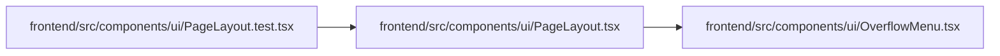

# PageLayout Module

**Path:** `frontend/src/components/ui/PageLayout.tsx`

## Description

_Auto-generated from `frontend/src/components/ui/PageLayout.tsx`._

## Imports

| Source | Symbols | Type-only | Runtime emission |
|--------|---------|-----------|------------------|
| `./OverflowMenu` | `OverflowMenuItem` | Specifier | compiler-dependent |
| `./OverflowMenu` | `OverflowMenu` | — | compiler-dependent |
| `clsx` | `clsx` | — | compiler-dependent |
| `react` | `ReactNode` | Declaration | erased |
| `react` | `Children`, `Fragment`, `cloneElement`, `isValidElement` | — | compiler-dependent |

## Module Signals

| Signal | Values |
|--------|--------|
| Exports | `FormGrid`, `InlineField`, `PageActions`, `PageHeader`, `PageLayout`, `TableFrame` |
| Constants | `MAX_SECONDARY_ACTIONS` |

## Local dependency map

<!-- Auto-generated local dependency summary. Do not edit by hand. -->
This graph shows full source coupling. Type dependencies can be erased; compiler-dependent cycle groups are runtime candidates, not confirmed initialization cycles.

### Internal neighbors

| Direction | Module |
|---|---|
| Inbound | [PageLayout.test](../modules/PageLayout.test.md) |
| Outbound | [OverflowMenu](../modules/OverflowMenu.md) |

### External packages

| Language | Used packages | Undeclared packages |
|---|---:|---:|
| typescript | 2 | 0 |

## Classes

| Class | Kind | Line | Bases / Target | Description |
|-------|------|------|----------------|-------------|
| [PageLayoutProps](../entities/PageLayoutProps.md) | Type alias | 6 | <pre><code>&#123;&#10;    children&#58; ReactNode&#59;&#10;    variant&#63;&#58; &#39;default&#39; &#124; &#39;wide&#39; &#124; &#39;workbench&#39;&#59;&#10;    className&#63;&#58; string&#59;&#10;    testId&#63;&#58; string&#59;&#10;&#125;</code></pre> | — |
| [PageHeaderProps](../entities/PageHeaderProps.md) | Type alias | 26 | <pre><code>&#123;&#10;    title&#58; ReactNode&#59;&#10;    &#47;&#42;&#42; One sentence saying what the page is for&#46; &#42;&#47;&#10;    purpose&#63;&#58; ReactNode&#59;&#10;    &#47;&#42;&#42; The one action the page leads with&#46; A second one is refused in development&#46; &#42;&#47;&#10;    primaryAction&#63;&#58; ReactNode&#59;&#10;    &#47;&#42;&#42; Up to two supporting actions&#46; &#42;&#47;&#10;    secondaryActions&#63;&#58; ReactNode&#59;&#10;    &#47;&#42;&#42; Every further page&#45;level action&#44; shown in one overflow menu&#46; &#42;&#47;&#10;    overflowItems&#63;&#58; OverflowMenuItem&#91;&#93;&#59;&#10;    &#47;&#42;&#42; A control that sets the scope of the page&#44; placed before the actions&#46; &#42;&#47;&#10;    context&#63;&#58; ReactNode&#59;&#10;    &#47;&#42;&#42; Pre&#45;built overflow control&#44; for callers that already own the menu&#46; &#42;&#47;&#10;    overflow&#63;&#58; ReactNode&#59;&#10;    meta&#63;&#58; ReactNode&#59;&#10;    className&#63;&#58; string&#59;&#10;    &#47;&#42;&#42; &#64;deprecated Use &#96;purpose&#96;&#46; &#42;&#47;&#10;    subtitle&#63;&#58; ReactNode&#59;&#10;    &#47;&#42;&#42; &#64;deprecated Use &#96;primaryAction&#96;&#44; &#96;secondaryActions&#96; and &#96;overflowItems&#96;&#46; &#42;&#47;&#10;    actions&#63;&#58; ReactNode&#59;&#10;    &#47;&#42;&#42;&#10;     &#42; Compatibility path for pages that still hand over more than two supporting&#10;     &#42; actions&#58; the secondary slot is rendered exactly as given&#46; The one&#45;primary&#10;     &#42; limit is not affected&#46; New pages must not set it&#46;&#10;     &#42;&#47;&#10;    unlimitedSecondaryActions&#63;&#58; boolean&#59;&#10;&#125;</code></pre> | — |

## Functions

| Function | Signature | Decorators | Description |
|----------|-----------|------------|-------------|
| `PageLayout` | `({ children, variant = 'default', className, testId }: PageLayoutProps)` | — | — |
| `PageHeader` | <pre><code>&#40;&#123;&#10;    title&#44;&#10;    purpose&#44;&#10;    subtitle&#44;&#10;    primaryAction&#44;&#10;    secondaryActions&#44;&#10;    overflowItems&#44;&#10;    overflow&#44;&#10;    context&#44;&#10;    meta&#44;&#10;    actions&#44;&#10;    unlimitedSecondaryActions &#61; false&#44;&#10;    className&#44;&#10;&#125;&#58; PageHeaderProps&#41;</code></pre> | — | The header every page opens with. |
| `PageActions` | `({ children, className }: { children: ReactNode; className?: string })` | — | — |
| `FormGrid` | `({ children, className }: { children: ReactNode; className?: string })` | — | — |
| `InlineField` | <pre><code>&#40;&#123;&#10;    label&#44;&#10;    children&#44;&#10;    hint&#44;&#10;    className&#44;&#10;&#125;&#58; &#123;&#10;    label&#58; ReactNode&#59;&#10;    children&#58; ReactNode&#59;&#10;    hint&#63;&#58; ReactNode&#59;&#10;    className&#63;&#58; string&#59;&#10;&#125;&#41;</code></pre> | — | — |
| `TableFrame` | `({ children, className }: { children: ReactNode; className?: string })` | — | — |
