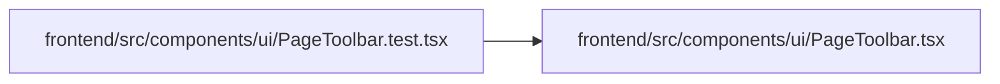

# PageToolbar Module

**Path:** `frontend/src/components/ui/PageToolbar.tsx`

## Description

_Auto-generated from `frontend/src/components/ui/PageToolbar.tsx`._

## Imports

| Source | Symbols | Type-only | Runtime emission |
|--------|---------|-----------|------------------|
| `clsx` | `clsx` | — | compiler-dependent |
| `react` | `ReactNode` | Declaration | erased |

## Module Signals

| Signal | Values |
|--------|--------|
| Exports | `PageToolbar` |

## Local dependency map

<!-- Auto-generated local dependency summary. Do not edit by hand. -->

### Internal neighbors

| Direction | Module |
|---|---|
| Inbound | [PageToolbar.test](../modules/PageToolbar.test.md) |

### External packages

| Language | Used packages | Undeclared packages |
|---|---:|---:|
| typescript | 2 | 0 |

## Functions

| Function | Signature | Decorators | Description |
|----------|-----------|------------|-------------|
| `PageToolbar` | <pre><code>&#40;&#123; search&#44; filters&#44; viewSwitch&#44; viewOptions&#44; label&#44; compact &#61; false&#44; className &#125;&#58; &#123;&#10;    search&#63;&#58; ReactNode&#59;&#10;    filters&#63;&#58; ReactNode&#59;&#10;    viewSwitch&#63;&#58; ReactNode&#59;&#10;    viewOptions&#63;&#58; ReactNode&#59;&#10;    &#47;&#42;&#42; Accessible name of the toolbar region&#46; &#42;&#47;&#10;    label&#63;&#58; string&#59;&#10;    &#47;&#42;&#42; Up to five quick filters&#58; keep one row down to about 900px of content&#46; &#42;&#47;&#10;    compact&#63;&#58; boolean&#59;&#10;    className&#63;&#58; string&#59;&#10;&#125;&#41;</code></pre> | — | The single row of controls above a page's records. |
