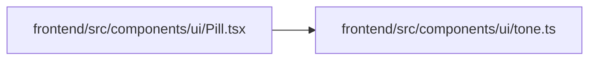

# Pill Module

**Path:** `frontend/src/components/ui/Pill.tsx`

## Description

_Auto-generated from `frontend/src/components/ui/Pill.tsx`._

## Imports

| Source | Symbols | Type-only | Runtime emission |
|--------|---------|-----------|------------------|
| `./tone` | `PillTone` | Declaration | erased |
| `./tone` | `wcPillClass` | — | compiler-dependent |
| `clsx` | `clsx` | — | compiler-dependent |
| `react` | `ReactNode` | Declaration | erased |

## Module Signals

| Signal | Values |
|--------|--------|
| Exports | `Pill` |

## Local dependency map

<!-- Auto-generated local dependency summary. Do not edit by hand. -->
This graph shows full source coupling. Type dependencies can be erased; compiler-dependent cycle groups are runtime candidates, not confirmed initialization cycles.

### Internal neighbors

| Direction | Module |
|---|---|
| Outbound | [tone](../modules/tone.md) |

### External packages

| Language | Used packages | Undeclared packages |
|---|---:|---:|
| typescript | 2 | 0 |

## Functions

| Function | Signature | Decorators | Description |
|----------|-----------|------------|-------------|
| `Pill` | <pre><code>&#40;&#123;&#10;    tone &#61; &#39;gray&#39;&#44;&#10;    icon&#44;&#10;    children&#44;&#10;    className&#44;&#10;&#125;&#58; &#123;&#10;    tone&#63;&#58; PillTone&#59;&#10;    icon&#63;&#58; ReactNode&#59;&#10;    children&#58; ReactNode&#59;&#10;    className&#63;&#58; string&#59;&#10;&#125;&#41;</code></pre> | — | — |
