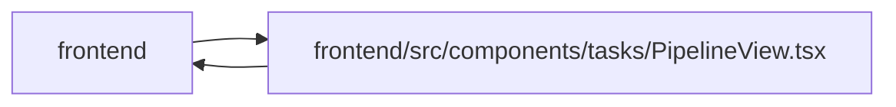

# PipelineView Module

**Path:** `frontend/src/components/tasks/PipelineView.tsx`

## Description

_Auto-generated from `frontend/src/components/tasks/PipelineView.tsx`._

## Imports

| Source | Symbols | Type-only | Runtime emission |
|--------|---------|-----------|------------------|
| `../../features/firstRun/NextStepEmptyState` | `NextStepEmptyState` | — | compiler-dependent |
| `../../features/firstRun/firstRunSteps` | `firstRunPlanHref` | — | compiler-dependent |
| `../../features/overview/overviewSignals` | `pipelineTasksInScope` | — | compiler-dependent |
| `../../features/scope/useScopeLink` | `useScopeLink` | — | compiler-dependent |
| `../../features/scope/workScope` | `ScopeIteration`, `ScopeProject` | Declaration | erased |
| `../../types/label` | `LabelGroup` | Declaration | erased |
| `../../types/task` | `Task` | Declaration | erased |
| `../../utils/taskFilters` | `taskMatchesFilters` | — | compiler-dependent |
| `../common/Button` | `Button` | — | compiler-dependent |
| `../feedback/QueryState` | `QueryErrorState`, `QueryLoadingState`, `QueryStaleState` | — | compiler-dependent |
| `../settings/AdminAccessGate` | `AdminAccessGate` | — | compiler-dependent |
| `../ui/InlineEmptyState` | `InlineEmptyState` | — | compiler-dependent |
| `../ui/tone` | `priorityChipClassName` | — | compiler-dependent |
| `./TaskAssigneeDisplay` | `TaskAssigneeDisplay` | — | compiler-dependent |
| `./TaskFiltersBar` | `TaskFilters` | Declaration | erased |
| `./usePipeline` | `usePipeline` | — | compiler-dependent |
| `clsx` | `clsx` | — | compiler-dependent |
| `lucide-react` | `Calendar`, `Folder` | — | compiler-dependent |
| `react-i18next` | `useTranslation` | — | compiler-dependent |
| `react-router-dom` | `useSearchParams` | — | compiler-dependent |

## Module Signals

| Signal | Values |
|--------|--------|
| Exports | `PipelineView` |
| Constants | `HUMAN_GATED_STAGES`, `STAGE_ACTION_KEYS` |
| Module calls | `HUMAN_GATED_STAGES = Set` |

## Local dependency map

<!-- Auto-generated local dependency summary. Do not edit by hand. -->
This graph shows full source coupling. Type dependencies can be erased; compiler-dependent cycle groups are runtime candidates, not confirmed initialization cycles.

> Module-level dependencies exceed the generated-diagram limits, so the diagram and table below group them by top-level package. Counts report the number of module neighbors in each package.

### Internal neighbors

| Direction | Module |
|---|---|
| Inbound | `frontend` (2) |
| Outbound | `frontend` (16) |

### External packages

| Language | Used packages | Undeclared packages |
|---|---:|---:|
| typescript | 4 | 0 |

> All 18 module neighbor(s) are summarized by package because the module-level view exceeds the 12-node limit.

## Functions

| Function | Signature | Decorators | Description |
|----------|-----------|------------|-------------|
| `PipelineView` | <pre><code>&#40;&#123; query&#44; project&#44; iteration&#44; search&#44; agent&#44; filters&#44; labelGroups&#44; onOpenTask&#44; hasActiveFilters &#61; false&#44; onClearFilters &#125;&#58; &#123;&#10;    query&#58; ReturnType&#60;typeof usePipeline&#62;&#59;&#10;    project&#58; ScopeProject &#124; undefined&#59;&#10;    iteration&#58; ScopeIteration &#124; undefined&#59;&#10;    search&#58; string&#59;&#10;    agent&#58; string&#59;&#10;    filters&#58; TaskFilters&#59;&#10;    labelGroups&#58; LabelGroup&#91;&#93;&#59;&#10;    onOpenTask&#58; &#40;task&#58; Task&#41; &#61;&#62; void&#59;&#10;    hasActiveFilters&#63;&#58; boolean&#59;&#10;    onClearFilters&#63;&#58; &#40;&#41; &#61;&#62; void&#59;&#10;&#125;&#41;</code></pre> | — | — |
