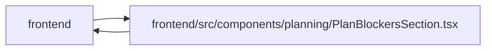

# PlanBlockersSection Module

**Path:** `frontend/src/components/planning/PlanBlockersSection.tsx`

## Description

_Auto-generated from `frontend/src/components/planning/PlanBlockersSection.tsx`._

## Imports

| Source | Symbols | Type-only | Runtime emission |
|--------|---------|-----------|------------------|
| `../../components/common/Select` | `Select` | — | compiler-dependent |
| `../../features/planningMasters/planningTaskIssues` | `planningIssueTasksHref`, `taskMatchesPlanningIssue` | — | compiler-dependent |
| `../../features/scope/useScopeLink` | `useScopeLink` | — | compiler-dependent |
| `../../services/iterationService` | `iterationService` | — | compiler-dependent |
| `../../services/labelService` | `labelService` | — | compiler-dependent |
| `../../services/taskService` | `taskService` | — | compiler-dependent |
| `../../services/teamService` | `teamService` | — | compiler-dependent |
| `../../types/task` | `Task`, `TaskBulkOperationRequest`, `TaskBulkOperationResponse` | Declaration | erased |
| `../../types/team` | `TeamMember` | Declaration | erased |
| `../../utils/apiError` | `getApiErrorMessage` | — | compiler-dependent |
| `../../utils/workNumbers` | `formatDecimal` | — | compiler-dependent |
| `../common/Button` | `Button` | — | compiler-dependent |
| `../feedback/QueryState` | `QueryErrorState` | — | compiler-dependent |
| `@tanstack/react-query` | `useQuery`, `useQueryClient` | — | compiler-dependent |
| `lucide-react` | `Bot`, `UserRound` | — | compiler-dependent |
| `react` | `useMemo`, `useState` | — | compiler-dependent |
| `react-i18next` | `useTranslation` | — | compiler-dependent |
| `react-router-dom` | `Link` | — | compiler-dependent |

## Module Signals

| Signal | Values |
|--------|--------|
| Exports | `PlanBlockersSection` |

## Local dependency map

<!-- Auto-generated local dependency summary. Do not edit by hand. -->
This graph shows full source coupling. Type dependencies can be erased; compiler-dependent cycle groups are runtime candidates, not confirmed initialization cycles.

> Module-level dependencies exceed the generated-diagram limits, so the diagram and table below group them by top-level package. Counts report the number of module neighbors in each package.

### Internal neighbors

| Direction | Module |
|---|---|
| Inbound | `frontend` (1) |
| Outbound | `frontend` (13) |

### External packages

| Language | Used packages | Undeclared packages |
|---|---:|---:|
| typescript | 5 | 0 |

> All 14 module neighbor(s) are summarized by package because the module-level view exceeds the 12-node limit.

## Classes

| Class | Kind | Line | Bases / Target | Description |
|-------|------|------|----------------|-------------|
| [Props](../entities/PlanBlockersSection_Props.md) | Interface | 20 | — | — |
| [RowLoad](../entities/RowLoad.md) | Interface | 21 | — | — |
| [Batch](../entities/Batch.md) | Interface | 22 | — | — |

## Functions

| Function | Signature | Decorators | Description |
|----------|-----------|------------|-------------|
| `PlanBlockersSection` | `({ iterationId, tasks, members, unassignedCount, effortCount }: Props)` | — | — |
