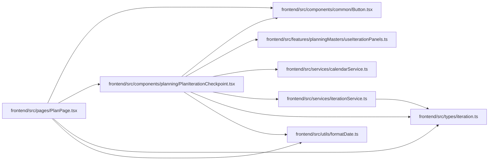

# PlanIterationCheckpoint Module

**Path:** `frontend/src/components/planning/PlanIterationCheckpoint.tsx`

## Description

_Auto-generated from `frontend/src/components/planning/PlanIterationCheckpoint.tsx`._

## Imports

| Source | Symbols | Type-only | Runtime emission |
|--------|---------|-----------|------------------|
| `../../features/planningMasters/useIterationPanels` | `useIterationPanels` | — | compiler-dependent |
| `../../services/calendarService` | `calendarService` | — | compiler-dependent |
| `../../services/iterationService` | `iterationService` | — | compiler-dependent |
| `../../types/iteration` | `Iteration` | Declaration | erased |
| `../../utils/formatDate` | `formatDate` | — | compiler-dependent |
| `../common/Button` | `Button` | — | compiler-dependent |
| `@tanstack/react-query` | `useQuery` | — | compiler-dependent |
| `react-i18next` | `useTranslation` | — | compiler-dependent |
| `react-router-dom` | `Link` | — | compiler-dependent |

## Module Signals

| Signal | Values |
|--------|--------|
| Exports | `PlanIterationCheckpoint` |

## Local dependency map

<!-- Auto-generated local dependency summary. Do not edit by hand. -->
This graph shows full source coupling. Type dependencies can be erased; compiler-dependent cycle groups are runtime candidates, not confirmed initialization cycles.

### Internal neighbors

| Direction | Module |
|---|---|
| Inbound | [PlanPage](../modules/PlanPage.md) |
| Outbound | [Button](../modules/Button.md) |
| Outbound | [useIterationPanels](../modules/useIterationPanels.md) |
| Outbound | [calendarService](../modules/calendarService.md) |
| Outbound | [iterationService](../modules/iterationService.md) |
| Outbound | [types_iteration](../modules/types_iteration.md) |
| Outbound | [formatDate](../modules/formatDate.md) |

### External packages

| Language | Used packages | Undeclared packages |
|---|---:|---:|
| typescript | 3 | 0 |

## Functions

| Function | Signature | Decorators | Description |
|----------|-----------|------------|-------------|
| `PlanIterationCheckpoint` | `({ iteration, done, calendarOutsideYear = false, readinessCalendarName }: { iteration: Iteration \| null; done: boolean; calendarOutsideYear?: boolean; readinessCalendarName?: string \| null })` | — | The body of the Iteration checkpoint: what the iteration in scope is, and the actions that manage |
