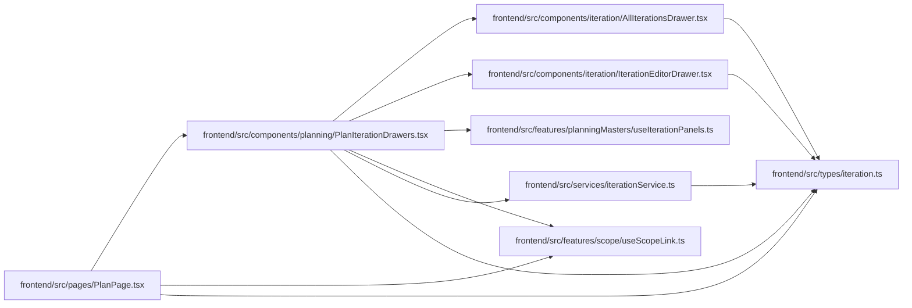

# PlanIterationDrawers Module

**Path:** `frontend/src/components/planning/PlanIterationDrawers.tsx`

## Description

_Auto-generated from `frontend/src/components/planning/PlanIterationDrawers.tsx`._

## Imports

| Source | Symbols | Type-only | Runtime emission |
|--------|---------|-----------|------------------|
| `../../features/planningMasters/useIterationPanels` | `useIterationPanels` | — | compiler-dependent |
| `../../features/scope/useScopeLink` | `useScopeLink`, `useLinkScope` | — | compiler-dependent |
| `../../services/iterationService` | `iterationService` | — | compiler-dependent |
| `../../types/iteration` | `Iteration` | Declaration | erased |
| `../iteration/AllIterationsDrawer` | `AllIterationsDrawer` | — | compiler-dependent |
| `../iteration/IterationEditorDrawer` | `IterationEditorDrawer` | — | compiler-dependent |
| `@tanstack/react-query` | `useQuery` | — | compiler-dependent |
| `react` | `useCallback`, `useEffect`, `useRef`, `useState` | — | compiler-dependent |
| `react-router-dom` | `useLocation`, `useNavigate` | — | compiler-dependent |

## Module Signals

| Signal | Values |
|--------|--------|
| Exports | `PlanIterationDrawers` |

## Local dependency map

<!-- Auto-generated local dependency summary. Do not edit by hand. -->
This graph shows full source coupling. Type dependencies can be erased; compiler-dependent cycle groups are runtime candidates, not confirmed initialization cycles.

### Internal neighbors

| Direction | Module |
|---|---|
| Inbound | [PlanPage](../modules/PlanPage.md) |
| Outbound | [AllIterationsDrawer](../modules/AllIterationsDrawer.md) |
| Outbound | [IterationEditorDrawer](../modules/IterationEditorDrawer.md) |
| Outbound | [useIterationPanels](../modules/useIterationPanels.md) |
| Outbound | [useScopeLink](../modules/useScopeLink.md) |
| Outbound | [iterationService](../modules/iterationService.md) |
| Outbound | [types_iteration](../modules/types_iteration.md) |

### External packages

| Language | Used packages | Undeclared packages |
|---|---:|---:|
| typescript | 3 | 0 |

## Functions

| Function | Signature | Decorators | Description |
|----------|-----------|------------|-------------|
| `PlanIterationDrawers` | `()` | — | The drawers that manage iterations from Plan: every iteration of the scope's project, and the |
