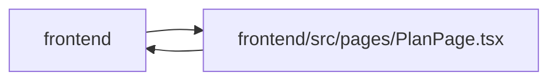

# PlanPage Module

**Path:** `frontend/src/pages/PlanPage.tsx`

## Description

Plan opens the requested checkpoint for the selected iteration, or the first incomplete checkpoint when no step is selected. Returning from another workspace refreshes the readiness data before choosing which checkpoint to reopen. A stale iteration parameter is removed from the URL.

## Imports

| Source | Symbols | Type-only | Runtime emission |
|--------|---------|-----------|------------------|
| `../components/capacity/CapacitySection` | `CapacitySection` | — | compiler-dependent |
| `../components/common/Button` | `Button` | — | compiler-dependent |
| `../components/common/ButtonLink` | `ButtonLink` | — | compiler-dependent |
| `../components/feedback/QueryState` | `QueryErrorState`, `QueryLoadingState` | — | compiler-dependent |
| `../components/planning/PlanBlockersSection` | `PlanBlockersSection` | — | compiler-dependent |
| `../components/planning/PlanIterationCheckpoint` | `PlanIterationCheckpoint` | — | compiler-dependent |
| `../components/planning/PlanIterationDrawers` | `PlanIterationDrawers` | — | compiler-dependent |
| `../components/planning/PlanReviewSection` | `PlanReviewSection` | — | compiler-dependent |
| `../components/planning/PlanScheduleSection` | `PlanScheduleSection` | — | compiler-dependent |
| `../components/planning/PlanWorkSection` | `PlanWorkSection` | — | compiler-dependent |
| `../components/ui` | `PageHeader`, `PageLayout` | — | compiler-dependent |
| `../features/firstRun/NextStepEmptyState` | `NextStepEmptyState` | — | compiler-dependent |
| `../features/firstRun/SetupReturnBar` | `SetupReturnBar` | — | compiler-dependent |
| `../features/firstRun/firstRunSteps` | `firstRunPlanHref` | — | compiler-dependent |
| `../features/firstRun/useFirstRunProgress` | `useFirstRunProgress` | — | compiler-dependent |
| `../features/planningMasters/planCheckpoints` | `PlanCheckpointSection`, `PlanCheckpointState` | Declaration | erased |
| `../features/planningMasters/planCheckpoints` | `firstIncompleteCheckpoint`, `planCheckpointSections` | — | compiler-dependent |
| `../features/planningMasters/planEvidence` | `checkpointEvidence`, `checkpointOwnerLink`, `readinessWithServerCounts` | — | compiler-dependent |
| `../features/planningMasters/planningReturn` | `PlanningStepId` | Declaration | erased |
| `../features/planningMasters/planningReturn` | `isPlanningStepId`, `PLAN_RETURNED_PARAM`, `PLANNING_STEP_IDS` | — | compiler-dependent |
| `../features/planningMasters/usePlanningNavigationSummary` | `planProgress` | — | compiler-dependent |
| `../features/planningMasters/usePlanningReadiness` | `PlanningQueryFeedback` | Declaration | erased |
| `../features/planningMasters/usePlanningReadiness` | `usePlanningReadiness` | — | compiler-dependent |
| `../features/scope/useScopeLink` | `useScopeLink` | — | compiler-dependent |
| `../types/iteration` | `IterationPlanningReadinessSummary` | Declaration | erased |
| `../utils/formatDate` | `formatDate` | — | compiler-dependent |
| `../utils/workNumbers` | `formatDecimal` | — | compiler-dependent |
| `@tanstack/react-query` | `useQueryClient` | — | compiler-dependent |
| `clsx` | `clsx` | — | compiler-dependent |
| `lucide-react` | `ArrowRight`, `Check`, `ChevronDown`, `RefreshCw` | — | compiler-dependent |
| `react` | `ReactNode` | Declaration | erased |
| `react` | `useEffect`, `useRef`, `useState` | — | compiler-dependent |
| `react-i18next` | `useTranslation` | — | compiler-dependent |
| `react-router-dom` | `Link`, `useSearchParams` | — | compiler-dependent |

## Module Signals

| Signal | Values |
|--------|--------|
| Exports | `default` |
| Constants | `STEP_PARAM`, `ITERATION_PARAM`, `STATE_PILL`, `SECTION_CLASS` |

## Local dependency map

<!-- Auto-generated local dependency summary. Do not edit by hand. -->
This graph shows full source coupling. Type dependencies can be erased; compiler-dependent cycle groups are runtime candidates, not confirmed initialization cycles.

> Module-level dependencies exceed the generated-diagram limits, so the diagram and table below group them by top-level package. Counts report the number of module neighbors in each package.

### Internal neighbors

| Direction | Module |
|---|---|
| Inbound | `frontend` (5) |
| Outbound | `frontend` (24) |

### External packages

| Language | Used packages | Undeclared packages |
|---|---:|---:|
| typescript | 6 | 0 |

> All 29 module neighbor(s) are summarized by package because the module-level view exceeds the 12-node limit.

## Classes

| Class | Kind | Line | Bases / Target | Description |
|-------|------|------|----------------|-------------|
| [Translate](../entities/PlanPage_Translate.md) | Type alias | 43 | `ReturnType<typeof useTranslation>['t']` | — |
| [Readiness](../entities/Readiness.md) | Type alias | 44 | `ReturnType<typeof usePlanningReadiness>` | — |