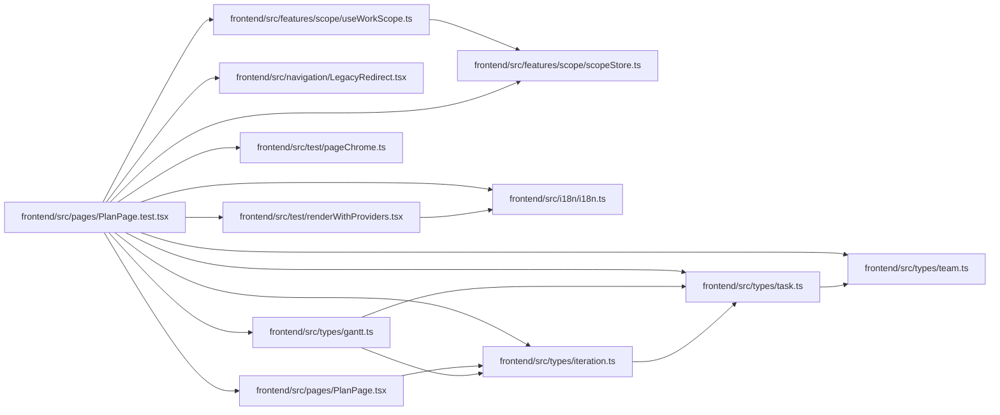

# PlanPage.test Module

**Path:** `frontend/src/pages/PlanPage.test.tsx`

## Description

_Auto-generated from `frontend/src/pages/PlanPage.test.tsx`._

## Imports

| Source | Symbols | Type-only | Runtime emission |
|--------|---------|-----------|------------------|
| `../features/scope/scopeStore` | `useScopeStore` | — | compiler-dependent |
| `../features/scope/useWorkScope` | `useSetWorkScope` | — | compiler-dependent |
| `../i18n/i18n` | `changeAppLanguage` | — | compiler-dependent |
| `../navigation/LegacyRedirect` | `LegacyRedirect` | — | compiler-dependent |
| `../test/pageChrome` | `expectPageChrome` | — | compiler-dependent |
| `../test/renderWithProviders` | `renderWithProviders` | — | compiler-dependent |
| `../types/gantt` | `GanttTask`, `SchedulePreviewResponse` | Declaration | erased |
| `../types/iteration` | `IterationPlanningReadinessSummary`, `PlanCheckpoint` | Declaration | erased |
| `../types/task` | `Task`, `TaskBulkOperationRequest` | Declaration | erased |
| `../types/team` | `TeamMember`, `TeamMemberCreate`, `TeamMemberProfile` | Declaration | erased |
| `./PlanPage` | `PlanPage` | — | compiler-dependent |
| `./PlanPage.tsx?raw` | `planPageSource` | — | compiler-dependent |
| `@testing-library/react` | `screen`, `waitFor`, `within` | — | compiler-dependent |
| `react-router-dom` | `Route`, `Routes`, `useLocation`, `useNavigate` | — | compiler-dependent |
| `vitest` | `afterEach`, `beforeEach`, `describe`, `expect`, `it`, `vi` | — | compiler-dependent |

## Module Signals

| Signal | Values |
|--------|--------|
| Constants | `services`, `planning`, `ITERATION`, `PLAN_ENTRY`, `FIXTURES`, `TITLES`, `IDS`, `BLOCKERS_ENTRY`, `scheduleReady` |
| Module calls | `services = hoisted`, `mock`, `mock`, `mock`, `mock`, `mock`, `mock`, `mock`, `mock`, `planning = hoisted`, `mock`, `beforeEach`, `afterEach`, `describe`, `describe`, `describe`, `scheduleReady = summary`, `describe`, `describe` |

## Local dependency map

<!-- Auto-generated local dependency summary. Do not edit by hand. -->
This graph shows full source coupling. Type dependencies can be erased; compiler-dependent cycle groups are runtime candidates, not confirmed initialization cycles.

### Internal neighbors

| Direction | Module |
|---|---|
| Outbound | [scopeStore](../modules/scopeStore.md) |
| Outbound | [useWorkScope](../modules/useWorkScope.md) |
| Outbound | [i18n](../modules/i18n.md) |
| Outbound | [LegacyRedirect](../modules/LegacyRedirect.md) |
| Outbound | [PlanPage](../modules/PlanPage.md) |
| Outbound | [pageChrome](../modules/pageChrome.md) |
| Outbound | [renderWithProviders](../modules/renderWithProviders.md) |
| Outbound | [types_gantt](../modules/types_gantt.md) |
| Outbound | [types_iteration](../modules/types_iteration.md) |
| Outbound | [types_task](../modules/types_task.md) |
| Outbound | [types_team](../modules/types_team.md) |

### External packages

| Language | Used packages | Undeclared packages |
|---|---:|---:|
| typescript | 3 | 0 |
