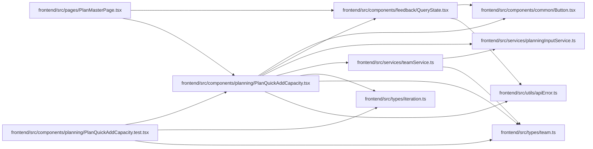

# PlanQuickAddCapacity Module

**Path:** `frontend/src/components/planning/PlanQuickAddCapacity.tsx`

## Description

_Auto-generated from `frontend/src/components/planning/PlanQuickAddCapacity.tsx`._

## Imports

| Source | Symbols | Type-only | Runtime emission |
|--------|---------|-----------|------------------|
| `../../services/planningInputService` | `planningInputService` | — | compiler-dependent |
| `../../services/teamService` | `teamService` | — | compiler-dependent |
| `../../types/iteration` | `Iteration` | Declaration | erased |
| `../../types/team` | `TeamMember`, `TeamMemberProfile` | Declaration | erased |
| `../../utils/apiError` | `getApiErrorMessage` | — | compiler-dependent |
| `../common/Button` | `Button` | — | compiler-dependent |
| `../feedback/QueryState` | `QueryErrorState` | — | compiler-dependent |
| `@tanstack/react-query` | `useMutation`, `useQuery`, `useQueryClient` | — | compiler-dependent |
| `react` | `useState` | — | compiler-dependent |
| `react-i18next` | `useTranslation` | — | compiler-dependent |

## Module Signals

| Signal | Values |
|--------|--------|
| Exports | `PlanQuickAddCapacity` |

## Local dependency map

<!-- Auto-generated local dependency summary. Do not edit by hand. -->
This graph shows full source coupling. Type dependencies can be erased; compiler-dependent cycle groups are runtime candidates, not confirmed initialization cycles.

### Internal neighbors

| Direction | Module |
|---|---|
| Inbound | [PlanQuickAddCapacity.test](../modules/PlanQuickAddCapacity.test.md) |
| Inbound | [PlanMasterPage](../modules/PlanMasterPage.md) |
| Outbound | [Button](../modules/Button.md) |
| Outbound | [QueryState](../modules/QueryState.md) |
| Outbound | [planningInputService](../modules/planningInputService.md) |
| Outbound | [teamService](../modules/teamService.md) |
| Outbound | [types_iteration](../modules/types_iteration.md) |
| Outbound | [types_team](../modules/types_team.md) |
| Outbound | [apiError](../modules/apiError.md) |

### External packages

| Language | Used packages | Undeclared packages |
|---|---:|---:|
| typescript | 3 | 0 |

## Functions

| Function | Signature | Decorators | Description |
|----------|-----------|------------|-------------|
| `PlanQuickAddCapacity` | `({ iteration, members }: { iteration: Iteration; members: TeamMember[] })` | — | Adds one capacity row from an existing profile without leaving the plan (the default case). |
