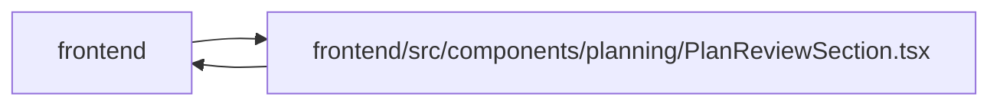

# PlanReviewSection Module

**Path:** `frontend/src/components/planning/PlanReviewSection.tsx`

## Description

_Auto-generated from `frontend/src/components/planning/PlanReviewSection.tsx`._

## Imports

| Source | Symbols | Type-only | Runtime emission |
|--------|---------|-----------|------------------|
| `../../features/planningMasters/atRiskReasons` | `atRiskReasons` | — | compiler-dependent |
| `../../features/planningMasters/planningReturn` | `withPlanReturn` | — | compiler-dependent |
| `../../features/planningMasters/planningTaskIssues` | `hasDeliverySignal`, `isFinished` | — | compiler-dependent |
| `../../features/planningMasters/scheduleEvidence` | `scheduleLeaves` | — | compiler-dependent |
| `../../features/planningMasters/usePlanScheduleWorkloads` | `usePlanScheduleWorkloads` | — | compiler-dependent |
| `../../features/scope/useScopeLink` | `useScopeLink` | — | compiler-dependent |
| `../../types/gantt` | `GanttResponse` | Declaration | erased |
| `../../types/iteration` | `Iteration` | Declaration | erased |
| `../../types/team` | `TeamMember` | Declaration | erased |
| `../../utils/formatDate` | `formatDate` | — | compiler-dependent |
| `../common/ButtonLink` | `ButtonLink` | — | compiler-dependent |
| `../feedback/QueryState` | `QueryErrorState`, `QueryLoadingState` | — | compiler-dependent |
| `./PlanShareSection` | `PlanShareSection` | — | compiler-dependent |
| `react-i18next` | `useTranslation` | — | compiler-dependent |
| `react-router-dom` | `Link` | — | compiler-dependent |

## Module Signals

| Signal | Values |
|--------|--------|
| Exports | `PlanReviewSection` |

## Local dependency map

<!-- Auto-generated local dependency summary. Do not edit by hand. -->
This graph shows full source coupling. Type dependencies can be erased; compiler-dependent cycle groups are runtime candidates, not confirmed initialization cycles.

> Module-level dependencies exceed the generated-diagram limits, so the diagram and table below group them by top-level package. Counts report the number of module neighbors in each package.

### Internal neighbors

| Direction | Module |
|---|---|
| Inbound | `frontend` (1) |
| Outbound | `frontend` (13) |

### External packages

| Language | Used packages | Undeclared packages |
|---|---:|---:|
| typescript | 2 | 0 |

> All 14 module neighbor(s) are summarized by package because the module-level view exceeds the 12-node limit.

## Functions

| Function | Signature | Decorators | Description |
|----------|-----------|------------|-------------|
| `PlanReviewSection` | <pre><code>&#40;&#123; iteration&#44; members&#44; gantt&#44; riskCount &#125;&#58; &#123;&#10;    iteration&#58; Iteration&#59; members&#58; TeamMember&#91;&#93;&#59; gantt&#63;&#58; GanttResponse&#59; riskCount&#58; number&#59;&#10;&#125;&#41;</code></pre> | — | — |
