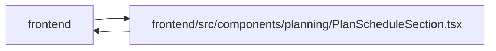

# PlanScheduleSection Module

**Path:** `frontend/src/components/planning/PlanScheduleSection.tsx`

## Description

_Auto-generated from `frontend/src/components/planning/PlanScheduleSection.tsx`._

## Imports

| Source | Symbols | Type-only | Runtime emission |
|--------|---------|-----------|------------------|
| `../../features/planningMasters/planningReturn` | `withPlanReturn` | — | compiler-dependent |
| `../../features/planningMasters/scheduleEvidence` | `scheduleLeaves` | — | compiler-dependent |
| `../../features/planningMasters/usePlanScheduleWorkloads` | `usePlanScheduleWorkloads` | — | compiler-dependent |
| `../../features/scope/useScopeLink` | `useScopeLink` | — | compiler-dependent |
| `../../services/ganttService` | `ganttService` | — | compiler-dependent |
| `../../types/gantt` | `GanttResponse`, `GanttTask`, `SchedulePreviewResponse` | Declaration | erased |
| `../../types/iteration` | `Iteration` | Declaration | erased |
| `../../types/task` | `Task` | Declaration | erased |
| `../../types/team` | `TeamMember` | Declaration | erased |
| `../../utils/apiError` | `getApiErrorMessage`, `getApiErrorStatus` | — | compiler-dependent |
| `../../utils/formatDate` | `formatDate` | — | compiler-dependent |
| `../../utils/workNumbers` | `formatDecimal` | — | compiler-dependent |
| `../common/Button` | `Button` | — | compiler-dependent |
| `../common/ButtonLink` | `ButtonLink` | — | compiler-dependent |
| `../feedback/QueryState` | `QueryErrorState`, `QueryLoadingState` | — | compiler-dependent |
| `@tanstack/react-query` | `useQueryClient` | — | compiler-dependent |
| `react` | `useState` | — | compiler-dependent |
| `react-i18next` | `useTranslation` | — | compiler-dependent |
| `react-router-dom` | `Link` | — | compiler-dependent |

## Module Signals

| Signal | Values |
|--------|--------|
| Exports | `PlanScheduleSection` |

## Local dependency map

<!-- Auto-generated local dependency summary. Do not edit by hand. -->
This graph shows full source coupling. Type dependencies can be erased; compiler-dependent cycle groups are runtime candidates, not confirmed initialization cycles.

> Module-level dependencies exceed the generated-diagram limits, so the diagram and table below group them by top-level package. Counts report the number of module neighbors in each package.

### Internal neighbors

| Direction | Module |
|---|---|
| Inbound | `frontend` (1) |
| Outbound | `frontend` (15) |

### External packages

| Language | Used packages | Undeclared packages |
|---|---:|---:|
| typescript | 4 | 0 |

> All 16 module neighbor(s) are summarized by package because the module-level view exceeds the 12-node limit.

## Classes

| Class | Kind | Line | Bases / Target | Description |
|-------|------|------|----------------|-------------|
| [ListedTask](../entities/PlanScheduleSection_ListedTask.md) | Type alias | 21 | `Pick<Task, 'id' \| 'start_date' \| 'end_date' \| 'is_deferred' \| 'effective_is_deferred'> & { children?: ListedTask[] }` | — |

## Functions

| Function | Signature | Decorators | Description |
|----------|-----------|------------|-------------|
| `PlanScheduleSection` | <pre><code>&#40;&#123; iteration&#44; members&#44; gantt&#44; tasks&#58; iterationTasks&#44; done &#125;&#58; &#123;&#10;    &#47;&#42;&#42; The iteration&#39;s tasks from the task list&#44; flattened&#44; deferred tasks included&#59; this section leaves those out&#46; &#42;&#47;&#10;    iteration&#58; Iteration&#59; members&#58; TeamMember&#91;&#93;&#59; gantt&#63;&#58; GanttResponse&#59; tasks&#58; Task&#91;&#93;&#59; done&#58; boolean&#59;&#10;&#125;&#41;</code></pre> | — | — |
