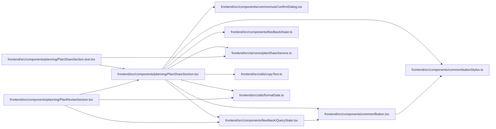

# PlanShareSection Module

**Path:** `frontend/src/components/planning/PlanShareSection.tsx`

## Description

_Auto-generated from `frontend/src/components/planning/PlanShareSection.tsx`._

## Imports

| Source | Symbols | Type-only | Runtime emission |
|--------|---------|-----------|------------------|
| `../../services/planShareService` | `PlanShare` | Declaration | erased |
| `../../services/planShareService` | `planShareService` | — | compiler-dependent |
| `../../utils/copyText` | `copyText` | — | compiler-dependent |
| `../../utils/formatDate` | `formatDateTime` | — | compiler-dependent |
| `../common/Button` | `Button` | — | compiler-dependent |
| `../common/buttonStyles` | `buttonClassName` | — | compiler-dependent |
| `../common/useConfirmDialog` | `useConfirmDialog` | — | compiler-dependent |
| `../feedback/QueryState` | `QueryErrorState`, `QueryLoadingState` | — | compiler-dependent |
| `../feedback/toast` | `useToast` | — | compiler-dependent |
| `@tanstack/react-query` | `useMutation`, `useQuery`, `useQueryClient` | — | compiler-dependent |
| `lucide-react` | `Copy`, `ExternalLink`, `RefreshCw`, `Share2` | — | compiler-dependent |
| `react` | `ReactNode` | Declaration | erased |
| `react` | `useEffect`, `useRef`, `useState` | — | compiler-dependent |
| `react-i18next` | `useTranslation` | — | compiler-dependent |

## Module Signals

| Signal | Values |
|--------|--------|
| Exports | `PlanShareSection` |

## Local dependency map

<!-- Auto-generated local dependency summary. Do not edit by hand. -->
This graph shows full source coupling. Type dependencies can be erased; compiler-dependent cycle groups are runtime candidates, not confirmed initialization cycles.

### Internal neighbors

| Direction | Module |
|---|---|
| Inbound | [PlanReviewSection](../modules/PlanReviewSection.md) |
| Inbound | [PlanShareSection.test](../modules/PlanShareSection.test.md) |
| Outbound | [Button](../modules/Button.md) |
| Outbound | [buttonStyles](../modules/buttonStyles.md) |
| Outbound | [useConfirmDialog](../modules/useConfirmDialog.md) |
| Outbound | [QueryState](../modules/QueryState.md) |
| Outbound | [toast](../modules/toast.md) |
| Outbound | [planShareService](../modules/planShareService.md) |
| Outbound | [copyText](../modules/copyText.md) |
| Outbound | [formatDate](../modules/formatDate.md) |

### External packages

| Language | Used packages | Undeclared packages |
|---|---:|---:|
| typescript | 4 | 0 |

## Classes

| Class | Kind | Line | Bases / Target | Description |
|-------|------|------|----------------|-------------|
| [FocusTarget](../entities/FocusTarget.md) | Type alias | 16 | `'ready' \| 'shared' \| 'retry' \| null` | — |

## Functions

| Function | Signature | Decorators | Description |
|----------|-----------|------------|-------------|
| `PlanShareSection` | `({ iterationId }: { iterationId: number })` | — | The read-only share link of an iteration's plan, made from the Review checkpoint. |
