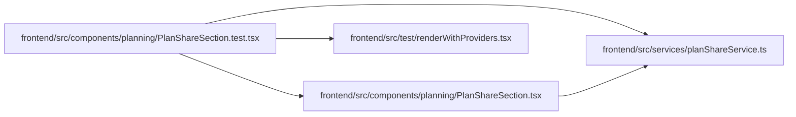

# PlanShareSection.test Module

**Path:** `frontend/src/components/planning/PlanShareSection.test.tsx`

## Description

_Auto-generated from `frontend/src/components/planning/PlanShareSection.test.tsx`._

## Imports

| Source | Symbols | Type-only | Runtime emission |
|--------|---------|-----------|------------------|
| `../../services/planShareService` | `PlanShare` | Declaration | erased |
| `../../test/renderWithProviders` | `renderWithProviders` | — | compiler-dependent |
| `./PlanShareSection` | `PlanShareSection` | — | compiler-dependent |
| `@testing-library/react` | `screen`, `waitFor`, `within` | — | compiler-dependent |
| `vitest` | `describe`, `expect`, `it`, `vi` | — | compiler-dependent |

## Module Signals

| Signal | Values |
|--------|--------|
| Constants | `service`, `share`, `revokeDialogName` |
| Module calls | `service = hoisted`, `mock`, `describe` |

## Local dependency map

<!-- Auto-generated local dependency summary. Do not edit by hand. -->
This graph shows full source coupling. Type dependencies can be erased; compiler-dependent cycle groups are runtime candidates, not confirmed initialization cycles.

### Internal neighbors

| Direction | Module |
|---|---|
| Outbound | [PlanShareSection](../modules/PlanShareSection.md) |
| Outbound | [planShareService](../modules/planShareService.md) |
| Outbound | [renderWithProviders](../modules/renderWithProviders.md) |

### External packages

| Language | Used packages | Undeclared packages |
|---|---:|---:|
| typescript | 2 | 0 |
