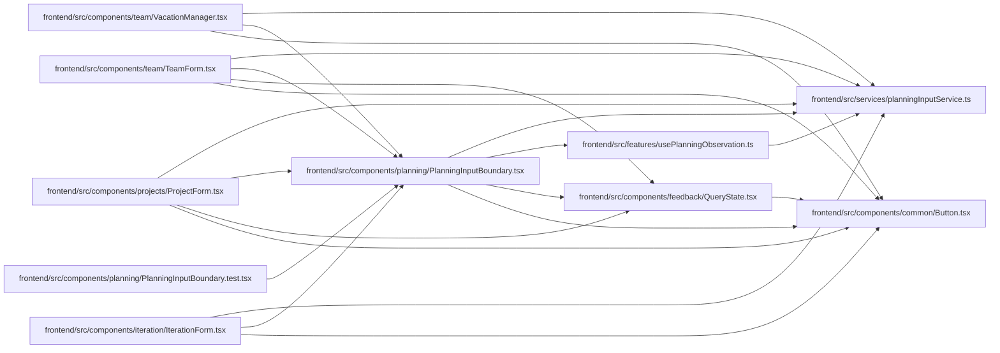

# PlanningInputBoundary Module

**Path:** `frontend/src/components/planning/PlanningInputBoundary.tsx`

## Description

Existing planning editors start from one coherent server resource and complete revision map. Explicit comparison retains user input; explicit reload starts a new editor generation. Scope and permission failures remain visible, and denied observations remove server data. Pending editors disable comparison controls.

## Imports

| Source | Symbols | Type-only | Runtime emission |
|--------|---------|-----------|------------------|
| `../../features/usePlanningObservation` | `usePlanningObservation` | — | compiler-dependent |
| `../../services/planningInputService` | `MemberPlanningIntent`, `ObservedPlanningInput`, `PlanningInputKind` | Declaration | erased |
| `../common/Button` | `Button` | — | compiler-dependent |
| `../feedback/QueryState` | `QueryErrorState`, `QueryLoadingState` | — | compiler-dependent |
| `react` | `ReactNode` | Specifier | compiler-dependent |
| `react` | `useEffect`, `useState` | — | compiler-dependent |
| `react-i18next` | `useTranslation` | — | compiler-dependent |

## Module Signals

| Signal | Values |
|--------|--------|
| Exports | `PlanningInputBoundary` |

## Local dependency map

<!-- Auto-generated local dependency summary. Do not edit by hand. -->
This graph shows full source coupling. Type dependencies can be erased; compiler-dependent cycle groups are runtime candidates, not confirmed initialization cycles.

### Internal neighbors

| Direction | Module |
|---|---|
| Inbound | [IterationForm](../modules/IterationForm.md) |
| Inbound | [PlanningInputBoundary.test](../modules/PlanningInputBoundary.test.md) |
| Inbound | [ProjectForm](../modules/ProjectForm.md) |
| Inbound | [TeamForm](../modules/TeamForm.md) |
| Inbound | [VacationManager](../modules/VacationManager.md) |
| Outbound | [Button](../modules/Button.md) |
| Outbound | [QueryState](../modules/QueryState.md) |
| Outbound | [usePlanningObservation](../modules/usePlanningObservation.md) |
| Outbound | [planningInputService](../modules/planningInputService.md) |

### External packages

| Language | Used packages | Undeclared packages |
|---|---:|---:|
| typescript | 2 | 0 |

## Functions

| Function | Signature | Decorators | Description |
|----------|-----------|------------|-------------|
| `PlanningInputBoundary` | <pre><code>&#60;T&#62;&#40;&#123; kind&#44; resourceId&#44; creatingMember &#61; false&#44; getIntent&#44; onCancel&#44; children &#125;&#58; &#123;&#10;    kind&#58; PlanningInputKind&#59; resourceId&#58; number&#59; creatingMember&#63;&#58; boolean&#59;&#10;    onCancel&#63;&#58; &#40;&#41; &#61;&#62; void&#59;&#10;    getIntent&#63;&#58; &#40;&#41; &#61;&#62; MemberPlanningIntent&#59;&#10;    children&#58; &#40;observation&#58; ObservedPlanningInput&#60;T&#62;&#44; controls&#58; ReactNode&#44; onSaved&#58; &#40;&#41; &#61;&#62; void&#41; &#61;&#62; ReactNode&#59;&#10;&#125;&#41;</code></pre> | — | — |