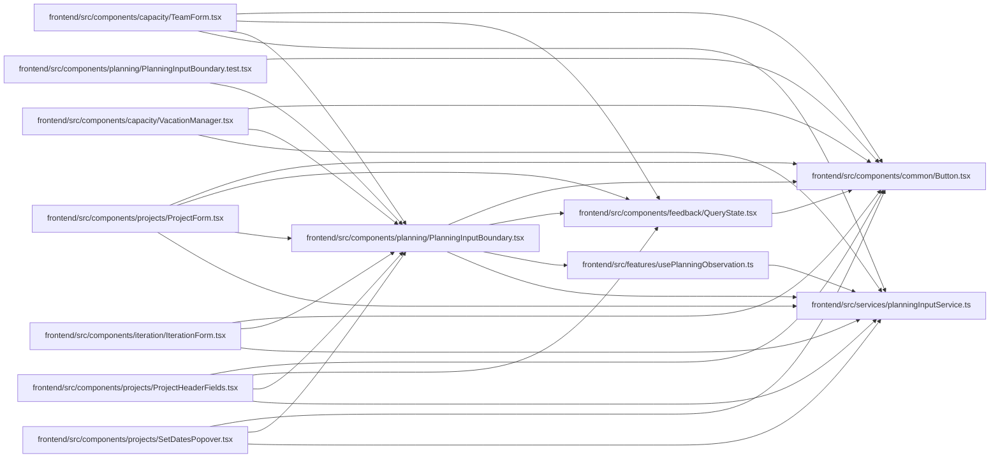

# PlanningInputBoundary Module

**Path:** `frontend/src/components/planning/PlanningInputBoundary.tsx`

## Description

Existing planning editors start from one coherent server resource and complete revision map. Explicit comparison retains user input; explicit reload starts a new editor generation. Scope and permission failures remain visible, and denied observations remove server data. Pending editors disable comparison controls.

When an iteration's annual calendar selection changes elsewhere, the editor presents that field for comparison before it accepts the newer revision. The comparison treats the selected IDs as a set, independent of the order returned by the reader.

## Imports

| Source | Symbols | Type-only | Runtime emission |
|--------|---------|-----------|------------------|
| `../../features/usePlanningObservation` | `usePlanningObservation` | — | compiler-dependent |
| `../../services/planningInputService` | `MemberPlanningIntent`, `ObservedPlanningInput`, `PlanningInputKind` | Declaration | erased |
| `../common/Button` | `Button` | — | compiler-dependent |
| `../feedback/QueryState` | `QueryErrorState`, `QueryLoadingState` | — | compiler-dependent |
| `react` | `ReactNode` | Specifier | compiler-dependent |
| `react` | `useEffect`, `useState` | — | compiler-dependent |
| `react-i18next` | `useTranslation` | — | compiler-dependent |

## Module Signals

| Signal | Values |
|--------|--------|
| Exports | `PlanningInputBoundary` |
| Constants | `WATCHED_FIELDS`, `DRAFT_FIELDS` |

## Local dependency map

<!-- Auto-generated local dependency summary. Do not edit by hand. -->
This graph shows full source coupling. Type dependencies can be erased; compiler-dependent cycle groups are runtime candidates, not confirmed initialization cycles.

### Internal neighbors

| Direction | Module |
|---|---|
| Inbound | [TeamForm](../modules/TeamForm.md) |
| Inbound | [VacationManager](../modules/VacationManager.md) |
| Inbound | [IterationForm](../modules/IterationForm.md) |
| Inbound | [PlanningInputBoundary.test](../modules/PlanningInputBoundary.test.md) |
| Inbound | [ProjectForm](../modules/ProjectForm.md) |
| Inbound | [ProjectHeaderFields](../modules/ProjectHeaderFields.md) |
| Inbound | [SetDatesPopover](../modules/SetDatesPopover.md) |
| Outbound | [Button](../modules/Button.md) |
| Outbound | [QueryState](../modules/QueryState.md) |
| Outbound | [usePlanningObservation](../modules/usePlanningObservation.md) |
| Outbound | [planningInputService](../modules/planningInputService.md) |

### External packages

| Language | Used packages | Undeclared packages |
|---|---:|---:|
| typescript | 2 | 0 |

## Functions

| Function | Signature | Decorators | Description |
|----------|-----------|------------|-------------|
| `PlanningInputBoundary` | <pre><code>&#60;T&#62;&#40;&#123; kind&#44; resourceId&#44; creatingMember &#61; false&#44; getIntent&#44; onCancel&#44; draft&#44; children &#125;&#58; &#123;&#10;    &#47;&#42;&#42; The record the form was opened with&#59; when given&#44; the conflict prompt shows only if the server&#39;s copy differs from it&#46; &#42;&#47;&#10;    draft&#63;&#58; object&#59;&#10;    kind&#58; PlanningInputKind&#59; resourceId&#58; number&#59; creatingMember&#63;&#58; boolean&#59;&#10;    onCancel&#63;&#58; &#40;&#41; &#61;&#62; void&#59;&#10;    getIntent&#63;&#58; &#40;&#41; &#61;&#62; MemberPlanningIntent&#59;&#10;    &#47;&#42;&#42;&#10;     &#42; &#96;reloaded&#96; is true once the person chose to load the server&#39;s latest version into the form&#46;&#10;     &#42; &#96;unresolved&#96; is true while the conflict prompt for a draft waits for one of its two choices&#59; the form must not save then&#46;&#10;     &#42;&#47;&#10;    children&#58; &#40;observation&#58; ObservedPlanningInput&#60;T&#62;&#44; controls&#58; ReactNode&#44; onSaved&#58; &#40;&#41; &#61;&#62; void&#44; onConflict&#58; &#40;&#41; &#61;&#62; void&#44; reloaded&#58; boolean&#44; unresolved&#58; boolean&#41; &#61;&#62; ReactNode&#59;&#10;&#125;&#41;</code></pre> | — | — |