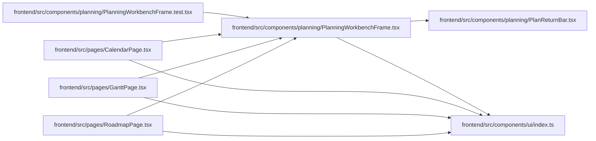

# PlanningWorkbenchFrame Module

**Path:** `frontend/src/components/planning/PlanningWorkbenchFrame.tsx`

## Description

_Auto-generated from `frontend/src/components/planning/PlanningWorkbenchFrame.tsx`._

## Imports

| Source | Symbols | Type-only | Runtime emission |
|--------|---------|-----------|------------------|
| `../ui` | `PageHeader`, `PageLayout` | — | compiler-dependent |
| `./PlanReturnBar` | `PlanReturnBar` | — | compiler-dependent |
| `clsx` | `clsx` | — | compiler-dependent |
| `react` | `ReactNode` | Declaration | erased |

## Module Signals

| Signal | Values |
|--------|--------|
| Exports | `PlanningWorkbenchFact`, `PlanningWorkbenchFrame` |

## Local dependency map

<!-- Auto-generated local dependency summary. Do not edit by hand. -->

### Internal neighbors

| Direction | Module |
|---|---|
| Inbound | [PlanningWorkbenchFrame.test](../modules/PlanningWorkbenchFrame.test.md) |
| Inbound | [CalendarPage](../modules/CalendarPage.md) |
| Inbound | [GanttPage](../modules/GanttPage.md) |
| Inbound | [RoadmapPage](../modules/RoadmapPage.md) |
| Outbound | [PlanReturnBar](../modules/PlanReturnBar.md) |
| Outbound | [index](../modules/index.md) |

### External packages

| Language | Used packages | Undeclared packages |
|---|---:|---:|
| typescript | 2 | 0 |

## Classes

| Class | Kind | Line | Bases / Target | Description |
|-------|------|------|----------------|-------------|
| [PlanningWorkbenchFact](../entities/PlanningWorkbenchFact.md) | Type alias | 6 | <pre><code>&#123;&#10;    id&#58; string&#59;&#10;    label&#58; ReactNode&#59;&#10;    value&#58; ReactNode&#59;&#10;&#125;</code></pre> | — |
| [PlanningWorkbenchFrameProps](../entities/PlanningWorkbenchFrameProps.md) | Type alias | 12 | <pre><code>&#123;&#10;    title&#58; ReactNode&#59;&#10;    description&#63;&#58; ReactNode&#59;&#10;    facts&#63;&#58; PlanningWorkbenchFact&#91;&#93;&#59;&#10;    contextControl&#63;&#58; ReactNode&#59;&#10;    secondaryActions&#63;&#58; ReactNode&#59;&#10;    primaryAction&#63;&#58; ReactNode&#59;&#10;    overflowAction&#63;&#58; ReactNode&#59;&#10;    state&#63;&#58; ReactNode&#59;&#10;    children&#58; ReactNode&#59;&#10;    variant&#63;&#58; &#39;default&#39; &#124; &#39;wide&#39; &#124; &#39;workbench&#39;&#59;&#10;    className&#63;&#58; string&#59;&#10;    headerClassName&#63;&#58; string&#59;&#10;    canvasClassName&#63;&#58; string&#59;&#10;    testId&#63;&#58; string&#59;&#10;&#125;</code></pre> | — |

## Functions

| Function | Signature | Decorators | Description |
|----------|-----------|------------|-------------|
| `PlanningWorkbenchFrame` | <pre><code>&#40;&#123;&#10;    title&#44;&#10;    description&#44;&#10;    facts &#61; &#91;&#93;&#44;&#10;    contextControl&#44;&#10;    secondaryActions&#44;&#10;    primaryAction&#44;&#10;    overflowAction&#44;&#10;    state&#44;&#10;    children&#44;&#10;    variant &#61; &#39;default&#39;&#44;&#10;    className&#44;&#10;    headerClassName&#44;&#10;    canvasClassName&#44;&#10;    testId&#44;&#10;&#125;&#58; PlanningWorkbenchFrameProps&#41;</code></pre> | — | — |
