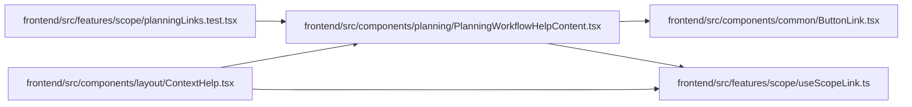

# PlanningWorkflowHelpContent Module

**Path:** `frontend/src/components/planning/PlanningWorkflowHelpContent.tsx`

## Description

_Auto-generated from `frontend/src/components/planning/PlanningWorkflowHelpContent.tsx`._

## Imports

| Source | Symbols | Type-only | Runtime emission |
|--------|---------|-----------|------------------|
| `../../features/scope/useScopeLink` | `useScopeLink` | — | compiler-dependent |
| `../common/ButtonLink` | `ButtonLink` | — | compiler-dependent |
| `lucide-react` | `LucideIcon` | Declaration | erased |
| `lucide-react` | `CalendarClock`, `ChevronRight`, `FlaskConical`, `History`, `ListChecks`, `LockKeyhole`, `Share2` | — | compiler-dependent |
| `react-i18next` | `useTranslation` | — | compiler-dependent |

## Module Signals

| Signal | Values |
|--------|--------|
| Exports | `PlanningWorkflowHelpContent` |

## Local dependency map

<!-- Auto-generated local dependency summary. Do not edit by hand. -->

### Internal neighbors

| Direction | Module |
|---|---|
| Inbound | [ContextHelp](../modules/ContextHelp.md) |
| Inbound | [planningLinks.test](../modules/planningLinks.test.md) |
| Outbound | [ButtonLink](../modules/ButtonLink.md) |
| Outbound | [useScopeLink](../modules/useScopeLink.md) |

### External packages

| Language | Used packages | Undeclared packages |
|---|---:|---:|
| typescript | 2 | 0 |

## Classes

| Class | Kind | Line | Bases / Target | Description |
|-------|------|------|----------------|-------------|
| [PlanningSurface](../entities/PlanningSurface.md) | Type alias | 15 | `'plan' \| 'gantt'` | — |
| [GuideItem](../entities/GuideItem.md) | Type alias | 17 | <pre><code>&#123;&#10;    icon&#58; LucideIcon&#59;&#10;    title&#58; string&#59;&#10;    body&#58; string&#59;&#10;&#125;</code></pre> | — |

## Functions

| Function | Signature | Decorators | Description |
|----------|-----------|------------|-------------|
| `PlanningWorkflowHelpContent` | <pre><code>&#40;&#123;&#10;    surface&#44;&#10;    showAction &#61; true&#44;&#10;    onNavigate&#44;&#10;&#125;&#58; &#123;&#10;    surface&#58; PlanningSurface&#59;&#10;    showAction&#63;&#58; boolean&#59;&#10;    onNavigate&#63;&#58; &#40;&#41; &#61;&#62; void&#59;&#10;&#125;&#41;</code></pre> | — | — |
