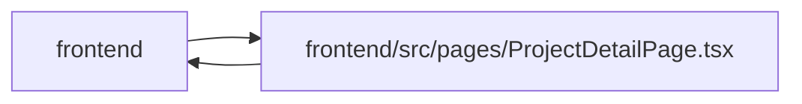

# ProjectDetailPage Module

**Path:** `frontend/src/pages/ProjectDetailPage.tsx`

## Description

_Auto-generated from `frontend/src/pages/ProjectDetailPage.tsx`._

## Imports

| Source | Symbols | Type-only | Runtime emission |
|--------|---------|-----------|------------------|
| `../components/common/Button` | `Button` | — | compiler-dependent |
| `../components/common/ConfirmDialog` | `ConfirmDialog` | — | compiler-dependent |
| `../components/feedback/QueryState` | `QueryErrorState` | — | compiler-dependent |
| `../components/feedback/toast` | `useToast` | — | compiler-dependent |
| `../components/layout/Breadcrumbs` | `Breadcrumbs` | — | compiler-dependent |
| `../components/projects/MilestoneFormDrawer` | `MilestoneFormDrawer` | — | compiler-dependent |
| `../components/projects/PostUpdateDrawer` | `PostUpdateDrawer` | — | compiler-dependent |
| `../components/projects/ProjectForm` | `ProjectForm` | — | compiler-dependent |
| `../components/projects/ProjectHeaderFields` | `ProjectHeaderFields` | — | compiler-dependent |
| `../components/projects/ProjectIterationsTab` | `ProjectIterationsTab` | — | compiler-dependent |
| `../components/projects/ProjectReleasesTab` | `ProjectReleasesTab` | — | compiler-dependent |
| `../components/projects/ProjectRequestsTab` | `ProjectRequestsTab` | — | compiler-dependent |
| `../components/projects/ProjectSummaryTab` | `ProjectSummaryTab` | — | compiler-dependent |
| `../components/projects/ProjectTasksTab` | `ProjectTasksTab` | — | compiler-dependent |
| `../components/projects/ProjectUpdatesTab` | `ProjectUpdatesTab` | — | compiler-dependent |
| `../components/projects/projectDetailShared` | `MilestoneEditorState`, `MilestoneFormState`, `ProjectUpdateErrorStore`, `ProjectUpdateFormState`, `ProjectUpdateFormStore` | Specifier | compiler-dependent |
| `../components/projects/projectDetailShared` | `buildMilestonePayload`, `createEmptyMilestoneForm`, `createEmptyUpdateForm`, `createMilestoneFormFromRecord`, `nullableTrimmedText` | — | compiler-dependent |
| `../components/releases/ReleaseForm` | `ReleaseForm` | — | compiler-dependent |
| `../components/ui` | `PageHeader`, `PageLayout`, `SlideOverDrawer` | — | compiler-dependent |
| `../features/mutationFeedback` | `MutationFeedbackMeta` | Declaration | erased |
| `../features/mutationFeedback` | `feedbackMessage` | — | compiler-dependent |
| `../services/planningInputService` | `ObservedPlanningInput` | Specifier | compiler-dependent |
| `../services/planningInputService` | `planningInputService` | — | compiler-dependent |
| `../services/projectService` | `projectService` | — | compiler-dependent |
| `../services/releaseService` | `releaseService` | — | compiler-dependent |
| `../types/project` | `Project`, `ProjectMilestone`, `ProjectMilestoneCreateRequest`, `ProjectMilestoneUpdateRequest` | Declaration | erased |
| `../utils/apiError` | `getApiErrorMessage`, `getApiErrorStatus`, `normalizeApiError` | — | compiler-dependent |
| `@tanstack/react-query` | `useMutation`, `useQuery`, `useQueryClient` | — | compiler-dependent |
| `clsx` | `clsx` | — | compiler-dependent |
| `lucide-react` | `Activity`, `Edit`, `Send`, `Trash2` | — | compiler-dependent |
| `react` | `FormEvent` | Declaration | erased |
| `react` | `useEffect`, `useState` | — | compiler-dependent |
| `react-i18next` | `useTranslation` | — | compiler-dependent |
| `react-router-dom` | `Link`, `useNavigate`, `useParams`, `useSearchParams` | — | compiler-dependent |

## Module Signals

| Signal | Values |
|--------|--------|
| Exports | `default` |

## Local dependency map

<!-- Auto-generated local dependency summary. Do not edit by hand. -->
This graph shows full source coupling. Type dependencies can be erased; compiler-dependent cycle groups are runtime candidates, not confirmed initialization cycles.

> Module-level dependencies exceed the generated-diagram limits, so the diagram and table below group them by top-level package. Counts report the number of module neighbors in each package.

### Internal neighbors

| Direction | Module |
|---|---|
| Inbound | `frontend` (1) |
| Outbound | `frontend` (24) |

### External packages

| Language | Used packages | Undeclared packages |
|---|---:|---:|
| typescript | 6 | 0 |

> All 25 module neighbor(s) are summarized by package because the module-level view exceeds the 12-node limit.
