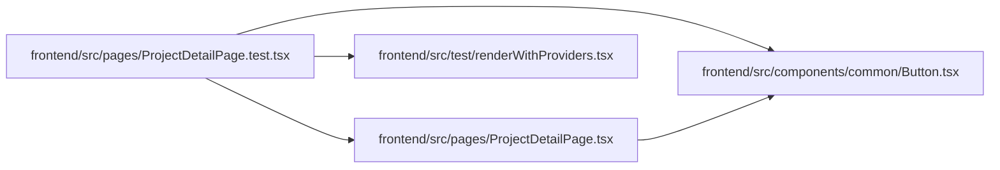

# ProjectDetailPage.test Module

**Path:** `frontend/src/pages/ProjectDetailPage.test.tsx`

## Description

_Auto-generated from `frontend/src/pages/ProjectDetailPage.test.tsx`._

## Imports

| Source | Symbols | Type-only | Runtime emission |
|--------|---------|-----------|------------------|
| `../components/common/Button` | `Button` | — | compiler-dependent |
| `../test/renderWithProviders` | `renderWithProviders` | — | compiler-dependent |
| `./ProjectDetailPage` | `ProjectDetailPage` | — | compiler-dependent |
| `@testing-library/react` | `fireEvent`, `screen`, `waitFor`, `within` | — | compiler-dependent |
| `react-router-dom` | `Route`, `Routes`, `useLocation`, `useNavigate` | — | compiler-dependent |
| `vitest` | `beforeEach`, `describe`, `expect`, `it`, `vi` | — | compiler-dependent |

## Module Signals

| Signal | Values |
|--------|--------|
| Constants | `services`, `project`, `revisions` |
| Module calls | `services = hoisted`, `mock`, `mock`, `mock`, `mock`, `mock`, `mock`, `mock`, `mock`, `beforeEach`, `describe`, `it`, `it`, `it`, `it`, `it` |

## Local dependency map

<!-- Auto-generated local dependency summary. Do not edit by hand. -->

### Internal neighbors

| Direction | Module |
|---|---|
| Outbound | [Button](../modules/Button.md) |
| Outbound | [ProjectDetailPage](../modules/ProjectDetailPage.md) |
| Outbound | [renderWithProviders](../modules/renderWithProviders.md) |

### External packages

| Language | Used packages | Undeclared packages |
|---|---:|---:|
| typescript | 3 | 0 |
